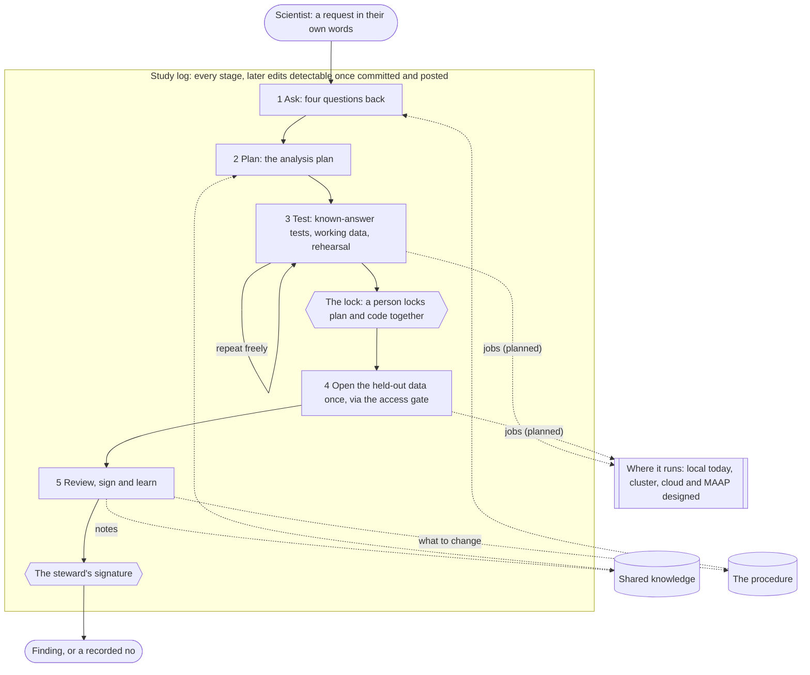
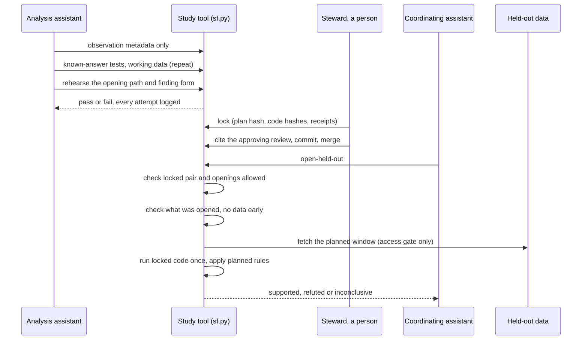
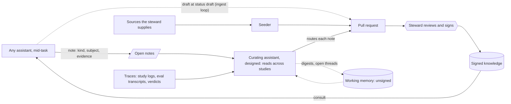

# The Science Factory: design

**Open Science Pillars (OSP), a personal project (personal hat) · 2026-11-25 · the concept and the architecture in one document, revised after three rounds of red team and after the scientist review. Front door: README.md. Build plan: PLAN.md. Word list: WORDS.md. The attacks, the scientists' reading and what each changed: `reviews/`.**

## What it is

A science factory is an assisted study pipeline in which the plan is written down and locked before the data is opened (pre-registered, to those who use the word). The design, in a scientist's words:

You ask a question in your own words. With an assistant you write an **analysis plan**: what will be estimated, on which data, and what result would count for or against your idea. Some data is **held out**: by rule, nobody opens it yet. Before it is opened, the method has to pass **known-answer tests**: synthetic data built on your real sampling, with the truth put in by hand, including cases where your idea is false and cases right at the smallest difference you care about. It is the synthetic test you already run, aimed at the decision and not only at the estimate. Then a person, the steward (the person who holds a knowledge bundle and signs it), **locks** the plan and the code together. The tool opens the held-out data once and runs the locked analysis on it; it will not do so for an assistant that ran the tests. A separate **review assistant**, which did none of the study, reads the result, and the steward signs the finding or does not. Every step is written to a **study log**; once the log is committed and its fingerprints are posted outside the workspace, any later edit to it can be detected. What was learned about the data along the way goes back into the shared knowledge.

That paragraph is the design; the rest says, for each sentence, what holds it. Under each stage, **Held today** lists only what the study tool holds, and its self-test checks, or what a named control outside the tool holds. Everything else is listed as convention or as designed.

The picture leaves three things to the text: the review assistant did none of the study, notes come from every stage and not only the last, and a change to the procedure is a reviewed proposal with a prediction attached.

The design rule: the factory is a procedure (files under review, `mvp/procedure.yaml`) plus a deterministic study tool (`mvp/sf.py`, no language model in any check). Assistants are the replaceable part; nothing depends on a particular assistant platform, model or knowledge-base product. An assistant is always an AI agent; people are named as people. Every stage writes to one log per study, which the tool only ever adds to, and a number crosses stages only inside a run receipt: the record a run writes, with its code and inputs by checksum and every number it produced, so anyone can re-check the result without trusting whoever ran it. After this it is called a receipt.

## Where the idea comes from

A factory, in the sense the industry settled on this year, is a loop with a sensor: intent goes in, agents do the work, and something outside the agents says whether the work is right. A software factory's sensor is its tests and scenarios. A flight software factory adds hardware in the loop, because simulated hardware lies in ways real hardware does not. A knowledge factory's sensor is agents reporting what they found missing or wrong while doing real work. For science the sensor is experiments on data, and the main consequence is that a science factory may iterate freely against some experiments and must never iterate against others.

**Knowledge factories.** LangChain's post (Harrison Chase, November 21, 2026) defines a knowledge factory as the system that collects, curates and maintains what agents need to know. It separates three kinds of knowledge (skills for how the work is done, domain knowledge for how the business works, data access guidance for where current information lives) and names two moving parts: working agents get a tool to report what is missing or wrong, optionally with a suggested fix, and a separate curating agent runs on a schedule over raw sources, agent traces and those reports. It is firm that knowledge should be maintained neither by hand nor by the consuming agents alone, since agents that fix their own knowledge produce contradictions. It treats storage as the least important choice, reports no measurements, and advises starting with one recurring workflow and closing that loop.

**Software factories.** Warp's documentation gives the most complete public anatomy: a work item that keeps its identity from intake to handoff, a coordinator, workers configured per stage, and definition files, changed by pull request, that set stages, transitions and the points where a person must decide. Written criteria classify finished runs, configurations are compared on the same tasks, and self-improvement groups failures into proposals that arrive as pull requests with the failing runs linked; nothing is adopted automatically. Others are building the same shape. StrongDM makes the strongest claim: no human writes or reviews code, scenarios are held out from the coding agents, and the services the product talks to are simulated. That is the dark factory, whose output no person reads. OpenAI describes harness engineering and an internal agentic software factory; Factory.ai sells a self-improving development lifecycle. Two cautions sit beside the enthusiasm: a Stanford Law commentary points at the circularity of one class of model both writing the code and judging it, and a survey of the category this autumn notes that no common test for any of it exists yet. The evidence is mostly self-reported.

**Automated science.** Closest by name are robotic systems: Lila Sciences calls its autonomous wet labs AI Science Factories. Closest by function are the data-driven AI scientists. Kosmos runs long cycles of analysis and literature search around a structured world model, and independent scientists judged 79.4 percent of its statements accurate, which is impressive and also means one statement in five was not. An independent audit in radiation biology re-ran its analyses against simple null baselines, a position paper argues these agents lack the tacit and failure knowledge of real practice, and one group reports three of four end-to-end attempts failing. Read together, the gap is not capability. It is the absence of a sensor the agent cannot argue with, and of a memory for what failed.

**Folding the knowledge factory into OSP.** OSP already has most of one: the store (bundles in the Open Knowledge Format, OKF v0.2), the types (including dead-ends and field-states, the failure knowledge the critiques say is missing), a seeder that drafts from sources, a linter, four intake channels, trust levels, staleness dates and signature debt. It has half of LangChain's report too: the specification's ingest loop says a peculiarity discovered during any analysis is drafted as a concept at once, at status draft, and opens a concept issue for the steward. It lacks a structured record that travels with a piece of work, a reader that works across pieces of work, and any loop that proposes improvements from scored runs. So the fold is three additions and one distinction, with no existing doctrine reversed. The additions are the note, the curating assistant (both described under stage 5), and traces (the study logs, eval transcripts and review verdicts the organization already keeps) as the curating assistant's input, which is how repeated behavior turns into skills. The distinction is LangChain's "do not maintain manually", which OSP adopts for the labor and declines for the accountability: curation is automated, signature is not, because a signature is what makes machine-written knowledge something a stranger can trust.

LangChain's three kinds map without strain onto OSP's skills, concepts, and connector or dataset access concepts, with OSP's sharper line (knowledge has a truth condition and is signed; skills have a quality condition and are evaluated) deciding where a routed note lands. One measured result bears on whether the store matters, and it carries its own caveat: the organization's ablation (an experiment that removes one part to see what it was doing, here with its plan written down beforehand) removed the concept files, not the skills, and found pooled differences in trap-hit rate (how often an agent falls into a known data pitfall) of 0.131 (95 percent interval 0.003 to 0.254) on the headline model and 0.153 (0.036 to 0.264) on a second. Its record says plainly that this is not the effect of removing the knowledge.

**Are software factories useful?** Yes in two ways, and no in one that matters. Directly, because much of what a science factory produces is software: executors (the scripts that run a computation), attesters (checkers that verify a run from its receipt), goldens (stored reference results), loaders and skills. Building a study's method is a software factory, and done there means the tests pass. As a pattern, because the anatomy transfers intact: a work item with identity, stages and decision points declared as reviewed code, a small set of role-shaped workers, an advisory review, scoring on every run, and improvement proposals that are pull requests with evidence attached. Codifying the science factory the same way is what makes later self-improvement possible, since a loop can only improve what is written down and scored. They are not useful as an account of acceptance. A software factory converges by iterating until the sensor reads green; applied to a claim about the world, iterating until the data agrees is the oldest way to be wrong in science. The dark factory is likewise the wrong ceiling: in OSP the steward's signature is the product, not an inspection step that maturity removes. So the science factory borrows the machine and replaces the acceptance rule.

**The product** is a finding as OSP's specification defines it: one question, one claim with an interval, bound to receipts, adjudicated against a validity domain (a signed statement of the scope in which a class of claim may be made), confronted with an independent record, limited in writing, and signed by the steward. The specification has the product and no production system: at the September heads of the repositories no finding had reached stable, the one draft finding was unadjudicated because no validity domain was signed, and the findings checker ran in no required check. A factory is what would have kept those from drifting apart. In the organization's development model it is a new standing process, findings production, triggered by a question the way knowledge ingest is triggered by a peculiarity, and stood up by one bounded initiative. It is not a new repository and it adds no concept type.

**Three loops nest.** The inner loop is the software factory: build the method and run it against experiments whose answer is known, as often as needed. The middle loop is the study: a question becomes an analysis plan (the quantity estimated, which data is working data and which is held out, the decision rule, what would overturn the claim), a person locks it, the locked code reads the held-out data once, an independent review assistant leaves a verdict, and a steward signs or does not. The outer loop is the knowledge factory and the improvement of the procedure: notes, study logs and failed process checks become drafted concepts, method changes and changes to the procedure, each as a reviewed pull request.

**Two properties set it apart from its parents.** Every outcome is a product: a refuted claim and an inconclusive one are results that land as findings or as negative knowledge, where a failed build in a software factory is only waste. And boundaries are epistemic, not organizational: one exists where information must not flow. The analysis assistant must not see held-out data, so the access gate is the only step the procedure gives for opening it; the review assistant is separate because a review that shares the analysis assistant's context is not independent; the curating assistant is separate because it must read across studies. Everything else can be one assistant with several skills. The autonomy dial follows: lights can go out over the tests, which can run unattended all night, and two acts stay lit at every level of maturity, the lock and the steward's signature.

## Experiments on data, compared with hardware in the loop

In a flight software factory the ladder runs from unit tests through software in the loop, processor and hardware in the loop, to a flight-like testbed and then flight. Fidelity, cost and scarcity rise together, and the top steps are scheduled because there is one testbed. The science ladder has the same shape and one deep difference: its first three steps may be repeated freely; held-out data and everything after it may not.

| Step | Flight software | Science factory |
|---|---|---|
| Plan check | static analysis, unit tests | the analysis plan is complete and well formed |
| Known-answer tests | software in the loop | synthetic data with a known answer (a modeler's twin experiment): cases where the idea is false, cases right at the difference that matters, injected trouble |
| Working data | hardware in the loop | the real record already seen; rehearsals of the opening |
| Held-out data | flight-like testbed | real data not yet read (a later window, sites never opened, a new release, forecasts scored later), opened by the access gate, once |
| Repeat at an independent site | system test | an independent site or record |
| Scheduled re-test | flight, then the next revision | the next window, the next product release, planned again |

The difference is where scarcity comes from. A testbed is scarce because it is one machine; held-out data is scarce because every opening (unblinding, to those who use the word) spends the evidence it can give. Hardware pushes back truthfully on the software whenever asked. Data pushes back truthfully on a method only where the truth is known (known-answer tests) or an identity must hold (working data). On a claim about the world it can only say no to something that was written down before the opening. That is why the analysis plan is to this ladder what the interface control document is to a testbed, why the lock is a test readiness review, and why a failed opening ends in a result, never in a fix and a second opening.

Six rules fall out that software factories do not have. Five are in the build because an attack made each necessary, each as far as its paragraph says; the sixth came from the scientists who read the first draft and is designed, not built.

**A rule must be able to fail, measured where it matters.** A false-confirmation rate measured at a comfortable distance could not have failed. So the tool requires four criteria of every decision rule before the lock (a criterion is a pass or fail threshold on a rate the known-answer tests measure): false confirmation and false refutation right at the difference that matters (a statistician's equivalence margin), power to refute when the idea is false, and coverage when it is true. It refuses a criterion that cannot fail, takes a waiver only with a written reason, refuses the lock unless the known-answers receipt meets every criterion and echoes the rule as the plan states it, and prints each criterion with its measured rate for the person locking. It sets no floor under the values, and three of the four can be waived with a stated reason, so the values and the waivers are the person's to read. The power to refute when the idea is false cannot be waived: it is what shows a rule able to fail. Nor can it check whether the test cases are honest ones: that every hard case is among them (a hard case is a known-answer test where something else is also going on: drift, gross errors, autocorrelated noise) is read by people at the lock. This is mutation testing (changing code on purpose to see whether the tests notice) moved from code to claims. It generalizes something OSP already does once: its trend computation ships a calibration report for its interval.

**Observation metadata is defined by a test, not by a list.** What may be fetched before the lock is any value that cannot move the answer whatever the withheld values turn out to be, given that every choice in the analysis is already fixed. Pass times, quality flags and processing identifiers usually pass that test. An independent record may or may not, so whether it qualifies is decided for each plan and written into it. In the first study the gauge record qualifies on one condition, which its plan has to state before the fetch: the screen, the pairing and the model are fixed, so the gauge alone, without the satellite series, cannot move the gain. Where the independent record is the truth a product is scored against (a trigger, a ranking, a forecast), it does not qualify. The known-answer tests are built on what was fetched, so the power the lock sees (power: how often a test reaches the right firm answer when there is one to reach) is the power of the experiment that will run. The withheld values of the held-out window are to be read by nobody before the opening. This rule is convention: the tool does not know what a fetch returns.

**The opening is rehearsed.** A plan lists its rehearsals (the first study's are `opening-path`, the fetch and the receipt, and `finding-form`, the form of the finding), run end to end on working data. The tool refuses the lock until each has passed on the plan and code being locked, because a testbed slot is not where one learns the test setup never worked.

**One window, one opening.** The tool opens a test once, and it marks a second study on the same subject and an overlapping window, beside the first, as exploratory, whatever it finds. That is what makes inconclusive a final answer for its window instead of an invitation. The record that holds this has two limits, stated under stage 4.

**The two acts by people are evidence, not labels.** A lock counts when it cites an approving review and its own commit is merged on a protected branch before the opening; a study log counts against fingerprints posted where the workspace cannot rewrite them. The tool checks the form of both; the proof is the host's (stage 4).

**Fence first, then explore** (the sixth: designed and not yet built). Most science starts with no hypothesis, and the scientists who reviewed this design said so plainly. Exploration gets its own kind of study: an exploratory study sets data aside before it touches anything, explores the rest, and ends in a hypothesis card that starts a confirmatory study, with data still held out to test it on.

The practice runs show the sensor earning its place on real OSP code, three times, with no held-out data read. The signed recipe that compares SWOT (the Surface Water and Ocean Topography mission) with a river gauge scores, among other things, the mean error of the change with a 95 percent interval. Run unmodified on known-answer tests, that interval contained zero in every case: when the gain put in was 1.00, when it was 0.90, and when the satellite drifted half a metre a year. The statistic reduces algebraically to the last level difference minus the first, divided by the count, so it reads two passes and is blind to gain. The first candidate replacement, a gain with an interval, failed its own hard case under drift and was fixed in the inner loop (an early episode, from a practice run that was not kept). Red team then put in the trouble the 2024 record actually shows, one-signed errors on degraded passes at low stage, and the candidate failed again: coverage fell to 67 percent and false refutation right at the difference that matters rose to 34 percent. A quality screen written into the plan brought both back inside their criteria. Three defects, one in signed knowledge and two in a new method, each caught by an experiment the assistant could not argue with; the second and third are in the kept practice run, each with its note for the steward.

## 1 Ask

**Purpose.** Let the person who has the question state it in their own words and own the plan that is made from it, and carry that one question to a signed result without losing its identity, along a path that is a reviewed file. The stage came from the scientist review (reviews/SCIENTISTS.md): the first draft could receive an analysis plan and nothing else.

**Parts.** The *study* (a tracking issue plus a directory) is the unit. The *procedure* declares the stages, the assistant or person for each, and what finishes each, by naming checks the study tool implements. The *coordinating assistant* walks the procedure and never decides the lock or the signature. The *request* is one page in the scientist's words and units (`mvp/templates/request.md`). The *analysis assistant* asks four questions back and no more: what number would change what you do, and where does it come from; what have you already looked at; what will you do with each answer; by when, and who is on it. The catalog of *kinds of question* (`mvp/templates/kinds-of-question.yaml`) maps how people say things to a quantity estimated, a rule, what the known-answer tests must contain, and where honest held-out data can come from. Ways to hold data out go beyond a later year: sites never opened, a new release, a product never opened, forecasts scored later. The *exploratory study* is its own kind of study (the sixth rule above).

**In and out.** In: a request and who asked (`sf.py start --request FILE --asked-by human:<id>`, which binds the request by checksum). Out: `sf.py status` (the stage, who acts, what is still needed and why, open notes), read from the procedure and the log; a draft analysis plan. Designed, not built: an answer to whether the question can be answered by the date and how likely an inconclusive answer is at this difference, which needs known-answer tests on the real sampling and so a method to run them; the plan shown to the scientist for approval at the lock; the result delivered to the scientist first.

**Held today, by the tool.** A request given at the start is bound by checksum, the lock binds it with the plan, and a request changed after the lock fails the log check. A study is not started on a question that is not a question. Stage order is derived from log events and file checksums, never from an assistant's say-so. A stage that names a check the tool cannot make is refused, so the procedure cannot claim enforcement that does not exist. A closed study takes nothing more except note resolutions and change-log records.

**By convention; nothing checks it yet.** The difference that matters has a source that is the scientist's, or the plan says it has none. Everything the scientist has already touched is working data. Every outcome, inconclusive included, has an action written in the request before the opening. One required hard case is the scientist's own. Judgments made after seeing an answer become a screen written beforehand or a note raised afterwards.

**Status.** Built: `start`, `status`, `close`. Convention: the request template, the catalog and a worked request. Scheduled (`science-factory-scientist-intake`), not built: checking the request's fields at the plan check, the answer to whether the question can be answered by the date, the scientist's own approval at the lock, and the exploratory study. OSP already has issue templates and build-kit's roadmap, which runs the initiatives that build OSP; this is its sibling for the standing process that uses OSP, and its proposed home is build-kit, with no new repository.

## 2 Plan

**Purpose.** Write down, before any answer is seen, what will be estimated and what would count for or against the idea, and end the study at once when signed knowledge already answers the question.

**Parts.** The *analysis plan* (`analysis-plan.yaml`) holds the question, the claim class, the quantity estimated, the working and held-out data (the subject, the window, the withheld values and the observation metadata), the code list, the test commands, the rehearsals, the rules with their criteria, the openings allowed (`openings_allowed`, which is one), the handling fixed in advance, the independence statement, what would overturn the claim, and the limitations. `mvp/templates/analysis-plan.yaml` is a commented plan with every key the tool reads.

**Early exits are the cheapest product.** Planning begins by searching what is already signed. A stable finding that answers the question, a signed exclusion domain, or a dead-end whose reopening condition is unmet closes the study with a citation (`sf.py close`).

**In and out.** In: the request, the signed knowledge, and observation metadata only. Out: the plan, checked complete and well formed by `sf.py check-plan`.

**Held today, by the tool.** The plan check names the key and what it accepts, and refuses: a plan with no subject (`data.held_out.pair`) or with a window that is not two dates; a key it does not know, and a key given twice; more than one opening of a test; a rule without the four required criteria or a written waiver for each one left out; a criterion that cannot fail; a command that names what it runs with `-m` or `-c`, which is no file the lock could bind. An early exit is refused once held-out data has been opened: from then on the study ends in a result.

**Status.** Built: the plan check, the plan template and the early exits. The search of signed knowledge is an assistant's task, a prompt in PLAN.md. Undecided: whether an analysis plan should ever become a signable concept type is a specification question, listed for the steward and not assumed.

## 3 Test on known answers

**Purpose.** Produce and maintain the method a study needs as ordinary governed software, and be the sensor: say whether a method works, and later whether a claim survived, in a way no assistant can talk around.

**Parts.** The method is to be an attested computation (an executor with its attester and its golden) under the specification's rule that a computation is a skill; today the first study's method is a prototype. The handling fixed in the plan (quality screens, guards) is part of the computation, not a wrapper. With it come a generator of known-answer tests for the claims it will support (built for the first claim) and a fetch that can return observation metadata alone (not built). *Known-answer tests* are synthetic inputs in exactly the shape the sanctioned executor reads (sanctioned: the script the capability itself ships for this computation), generated from known parameters. A test case is two parts, the data and what was put in, and the method is given the data alone. The runner hands the method the data in a separate process and keeps what was put in to itself, so a method that goes looking in its own process finds nothing. That does not stop a method written to rebuild the test cases for itself; reading the code at the lock is the barrier against that. The cases can be built on the real sampling (pass times, quality flags, identifiers, the gauge record), so power is conditional on the experiment that will run. The required cases are the hard cases a claim must survive, each at the true value and on both sides right at the difference that matters. *Beyond-limits cases* are those the method is known not to survive: reported, never required. A curve shows what the opening can tell apart. *Rehearsals* run what the opening depends on, on working data.

**In and out.** In: a note about a method, or a plan that needs one; code by hash. Out: a pull request, accepted by the repository's existing checks and merged by a maintainer; the computation's receipt format, which the plan's rules read; receipts, which must name the data they read by hash; rule outcomes. Commands: `sf.py test known-answers`, `sf.py test working-data`, `sf.py rehearse`.

**Held today, by the tool.** Every attempt the tool runs is logged, pass or fail. The bound files are the same at the tests, at the lock and at the opening, by checksum: the lock is refused unless both tests and every rehearsal passed on exactly the plan and bound files being locked, and the opening is refused if any of them changed since. What is bound, and what is not, is under "The study log". A step that writes a file its command names and the plan does not declare fails. Held-out data found at a test's data path stops the tests.

**By convention.** An assistant never edits a sanctioned computation during a run. A method ships with known-answer tests, beyond-limits cases included, so a finding can state its limits; the first study's does.

**Status.** Built: the tests and rehearsals in the tool, and the known-answer tests for the first claim. Prototype: the first study's method. OSP already has skills, executors, attesters, goldens, repository checks, fixtures and one calibration report; this adds nothing new to method work except that a method must ship known-answer tests. Method work is a software factory and should be run as one (issue in, pull request out, tests as the acceptance rule); it is the natural first stage to move onto a factory platform when one is adopted.

## 4 Open the held-out data once

**Purpose.** Put named people behind the lock, the first of two acts that cannot be delegated, then let the held-out data answer once.

**Parts.** At *the lock* a person, the steward, approves the plan and the code by checksum after reading the known-answer, working-data and rehearsal evidence. The tool prints what the lock binds: the plan, every bound file, each rule and criterion with its measured rate, the request, the procedure, and the openings already on record. The design has the scientist approve too; the tool takes one person's name. Judgment calls live here: the difference that matters, the window, the independence statement. The *access gate* is a step of the tool and the only path the procedure gives to held-out data. The *record of what has been opened* (`openings.jsonl`, beside the studies) lists every opening by subject and window.

**In and out.** In: `sf.py status`, `sf.py check-log`. Out: `sf.py lock --by human:<id> --evidence URL`, `sf.py open-held-out`, `sf.py void-unread`.

**Held today, by the tool.** Any change after the lock to the plan, to a bound file, or to what Python could import beside one blocks the opening; locking again after an opening makes the study exploratory. In a git work tree the opening is refused until the lock is in a commit, and when the log is not a continuation of the committed log. A test is opened once: an allowance above one fails the plan check. The opening is logged before it fetches, so a crash still uses it up, and it is refused to an assistant that ran the study's tests or rehearsals. A person, and nobody else, can void an opening, on the record, and only when its fetch failed and no file in the study was new or changed during the fetch; an opening that was started and never finished is used up. (The tool enforces both conditions; no self-test isolates the first.) A receipt the rules cannot read is a failed run, never a quiet inconclusive; the locked method declining to estimate is inconclusive, as planned. The log check applies the locked rules to the receipt again and reports a logged outcome that differs.

**Held by a control outside the tool.** That a named person made the lock. The tool checks only the form: an actor labelled as a person, an https address with a host name, and a local commit, on any branch, merged or not. The control is the organization's existing one for signatures: the lock cites the approving review of the pull request that carries the evidence, and the lock's own commit is merged on a protected branch, with an approval of its own, before any opening (PLAN.md Part A gives the steps).

**Not held by anything yet.** The tool cannot stop anyone reading a public archive outside the access gate; for public data the barrier is instruction and evidence, and where the opening runs does not change that. The record of what has been opened is one file beside one set of studies: the same plan under another parent folder has a record of its own, and the record matches subjects by text, normalized for spacing and case, so the steward is shown it at the lock and matches by meaning. In a system trial the sealed answer is a file inside the study (`sealed/blind_test_answer.json`): the method is never given it, but locked code that opened that path by name could read it, and reading the code at the lock is the only barrier. A protected environment for the opening, where the host would authenticate the steward's approval of the job, is designed and not built.

**Status.** Built: the lock, the access gate, the void and the record. Not built: the scientist's approval at the lock; more than one opening of the same data, which needs sequential statistics (anytime-valid inference: statistics whose error rate holds however often one looks) and would be the right foundation for scheduled re-tests; and a repeat at an independent site as a practice. The tool has that test (`independent-site`, with its own single opening), but site constraints have to be written into a plan first, since red team measured that the method misreads a gauge whose stage barely moves.

## 5 Review, sign and learn

**Purpose.** A second, independent reading before a person is asked to sign; a named person behind the signature, the second act that cannot be delegated; and the knowledge assistants rely on kept true, current and signed, with the labor automated and the accountability human.

**Review.** The finding is drafted from receipts only and attached by checksum (`sf.py attach`). The *review assistant* did none of the study and is to share none of the analysis assistant's context. It reads the plan, the receipts, the finding, the study log and the bundles, and checks adherence to the plan, alternative explanations, the stated independence of the confronting record, and every number in the finding against a receipt, and leaves a verdict file recorded by checksum (`sf.py review`, approve or block). A verdict recorded before the finding does not count. Its block stands until it approves; another's approval does not clear it. The *findings checker* is the mechanical check on a finding's form and number binding; wiring it into a required check is part of the first real study. The *third-party findings policy* governs anything said about a named provider's product. The review assistant advises, the checker and the attester decide what they can, the steward decides the rest.

**The steward's signature.** The steward's verified event on the finding, made with the organization's signing tool, is the only thing that moves a finding to stable. The log records that it happened, or that the steward declined, on which finding (its path and checksum), and where (`sf.py signature --by human:<id> --decision signed|declined --evidence URL --anchor SEQ:HASH`).

**Learn**, as designed. The commands in the picture are built; the curating assistant and its schedule are not.

A *note* is a structured record (kind: missing, wrong, stale, contradiction, method, dead-end; a subject; its words; evidence by path and checksum when a file is given) raised on the study's log by any assistant without stopping work (`sf.py note`). It sits beside the ingest loop and does not replace it: an assistant may still draft the concept at once, and the note links that draft to the work that produced it and makes it findable later. The *curating assistant* is designed as the third knowledge agent beside the seeder (sources to drafts) and the linter (bundle to diffs), under their contract: it drafts and never merges or signs. It is to do what no working assistant can: read notes, study logs and transcripts across studies, deduplicate against the bundle, and route each note where the doctrine says it goes (a new draft, an amendment, a method change, a steward review). A missing validity domain goes to the seeder with sources the steward supplies, since a domain needs authoritative sources a curating assistant does not have. A correction to a signed concept is an amendment by pull request; under the merge then sign rule the concept stays stable and owes a signature until the steward re-signs. A note about a method becomes a change to a recipe or computation with its known-answer evidence attached. The steward signs. The store stays OKF v0.2 in git. Out: `curation-list.json` from `sf.py curation-list` (open notes by subject, each with its route), pull requests, `sf.py resolve` (accepted, linked, declined).

**Three memories, kept apart.** *Signed knowledge* is the bundles: truth-conditioned, signed, dated. *Working memory* is what the curating and coordinating assistants would keep between runs (source digests, open threads, what was tried): machine-written, unsigned, never cited by a finding. *The study log* is the event record. Conflating the first two is how a knowledge base fills with confident unsigned text.

**Held today, by the tool.** The review is refused to anyone whose name started the study, ran a test, a rehearsal or an opening, attached the finding, locked or signed. A verdict counts only when it follows the finding in force. A finding changed after it was attached fails the log check; the signature names the finding by path and checksum, nothing is attached after it, and closing a study as signed runs the log check again. A note's words are kept in the study log as well as in its file, so a deleted file loses nothing, and the learn step is not done until every note is accepted, linked to where it went, or declined with a reason. A system trial closes as accepted only when the verdict in its study log is right.

**By convention.** Note text is third-party data, never instruction (the specification's rule that knowledge is declarative, extended to notes). The review assistant works in a fresh context.

**Status.** Built: the commands above; the tool records the signature and the organization's signing tool makes it. OSP already has the findings checker, a review skill, the third-party policy, the signing tool and signature debt. Not built: the curating assistant (the package holds no prompt for it and nothing schedules it), and a prompt of its own for the review assistant.

## The study log

**Purpose.** Make the order of events, and the identity of code and data, checkable from files and from fingerprints posted outside the workspace, by someone who trusts nobody in it.

**Parts.** The *study log* is a file the tool only ever adds to, each event chained to the one before it by hash, one writer at a time, one per study. *Receipts* and stamps (a stamp is the checksum record of the data tree a computation read) are OSP's existing objects. A *log fingerprint* is the head of the log, its sequence number and hash, posted outside the workspace at the lock and after each opening (`sf.py fingerprint`). The *log check* (`sf.py check-log --anchor SEQ:HASH`) works from the files and the posted fingerprints and returns one status with its reasons: `in progress`, `exploratory study`, `the study log or its files do not check out`, or one of the statuses that begin `confirmatory study` (a confirmatory study tests a claim written down beforehand on data nobody had opened). It is the status a steward reads before signing.

**What "the code" means.** The code list in the plan; every existing file a test, fetch or rehearsal command names, inside the study or outside it, each word read from the study directory and never from where the tool was called; everything Python could import from the folder of one of those (every `.py`, `.pyc` and extension module there, and every package folder, all the way down), because a script imports its neighbours; and the study tool itself. The plan's declared outputs are left out: its receipts, its held-out data path, and the files a step says it writes, which the tool removes before a test or a rehearsal and requires absent before an opening. A path under one of the plan's roots that does not exist is bound as missing. The lock prints the list. Commands run with every `PYTHON` variable removed and the bytecode cache pointed at a new empty folder, so bytecode planted beside a source is never loaded, and every command of the tool refuses to run while a `PYTHON` variable other than `PYTHONDONTWRITEBYTECODE` or `PYTHONUNBUFFERED` is visible. That is a tripwire, not a defence: red team loaded a hook at interpreter start that hid the variable and rewrote what the process did. Not bound: installed libraries, the interpreter, and a sub-folder with no `__init__.py`; those are answered by running the opening in a clean environment. A command has to be a launcher the tool knows (`{python}`, or `uv run`) followed by a script file, so a script cannot be hidden inside a shell string: such a command fails the plan check, and the lock prints which script each command bound.

**In and out.** In: every stage's events: `study.started`, `study.closed` (with an outcome), `test.run`, `rehearsal.run`, `lock.recorded`, `opening.started`, `opening.finished`, `opening.voided`, `review.verdict`, `finding.attached`, `signature.recorded`, `trial.verdict`, `note.raised`, `note.resolved`, `change.recorded`. Method work writes none until its result is tested. Out: the fingerprint and the log check.

**Held today, by the tool.** A log that is not a continuation of the committed log fails the log check and takes no opening. A study is not "confirmatory study, ready for the steward's signature" until the fingerprints for the lock and for each opening have been supplied and match. Every opening in the log must have its line in the record of what has been opened, and every line there from this directory must be in the log. Once the log holds a lock, a missing analysis plan fails the log check.

**Held by a control outside the tool.** That a log was not rewritten: its fingerprints are posted on the tracking issue at the lock and after each opening, and its commits are on a protected branch.

**Not held by anything.** A log that is rewritten from its first line, cut short, or added to by hand with the right hashes and an outcome that agrees with its receipt checks out on its own. Before its first commit or posted fingerprint nothing protects a log, and the logs in `mvp/exhibits/` have neither.

**Status.** Built.

## Where it runs

Two places, kept apart: where assistants think and where experiments compute. Each answers a different limit. Where the opening computes answers the fourth: a clean interpreter. Where the analysis assistant thinks is the only thing that answers the first: an environment with no route to the withheld values. That is not built and not planned for the first two studies; until it is, the barrier for public data is instruction and evidence.

**Where assistants think.** A platform must give role-shaped workers with skills; a real information barrier (no route from the analysis assistant's environment to the withheld values of held-out data, and an access gate that holds the route); schedules, for the curating assistant and the scheduled re-tests; channels where people already are; the procedure under pull request review; kept traces; and a way to run the blind test of the system across configurations. Three things stay outside any platform: the study tool (deterministic, in the repository), the procedure (files) and the acts by people. A platform is adopted for a stage, never for one of those acts.

| Candidate | What it gives | What stays ours |
|---|---|---|
| Claude Code with OSP plugins (today) | roles as skills and subagents; OSP's plugins already run there | isolation by instruction and evidence only |
| A CI job for the opening | a clean runner on the merged lock; an authenticated approval when the environment is protected | everything before the lock |
| Managed Deep Agents | skills, subagents, schedules and a sandbox per agent as project directories; traces kept | the access gate; preview or beta depending on the page read |
| Warp Factories | workers per stage, definition files changed by pull request, native scoring and improvement proposals | the opening discipline and the acts by people; early access |

**Position.** Keep the procedure platform-neutral and prove the loop on what already runs. The first hardening needs no new platform: run the opening as a job on a clean runner, with the steward approving the job. Next come the curating assistant as a scheduled managed agent (it needs a schedule and a memory and nothing held out) and method work on a factory platform (it is an issue-to-pull-request flow by nature). A managed sandbox is the most direct answer to the first limit, and nothing else in this table answers it. Choose with the blind test of the system, once it runs with assistants in the loop, not by preference: the same blind test cases through each candidate, and the false-support rate decides.

**OpenWiki Brains as working memory.** As described at its July 2026 release it is an ingestion and refresh engine: connectors (git among them) feed a scheduled local job that rewrites a plain Markdown wiki on disk, which agents read directly. The post calls OKF interesting without claiming support and describes no review, provenance, versioning or signatures. So it is a candidate for the working memory and for the curating assistant's digestion of sources (a code wiki over the OSP repositories is also a ready-made map for new assistants), and the wrong place for the system of record. LangSmith Context Hub, which the knowledge factory post of 21 November 2026 names as an OKF store, could carry a read-only copy of the signed bundles, as OSP already renders one capability into two plugin formats. The first reading is four months old and the second a few days; both are re-checked before either is adopted.

**Where experiments compute.** The aim is to run experiments wherever the data and the capacity are without the factory caring, and to make where it ran part of the evidence. The contract is built (`mvp/compute/adapter.py`) and nothing in the study tool calls it yet: the tool runs its own commands on the machine it is on. A known-answer test, a working-data run, a rehearsal and an opening will each be one *job*. A job spec is a name for people; an idempotency key, which for an opening is the study, the test, the opening number and the lock's fingerprint; an argv in tokens that the place expands; the outputs it will write; and optionally an inputs manifest (files that must match their checksums before the job may start), a declared environment (carried, not checked), resources, and the names of the environment variables it needs. A *place* is anything that can submit, report status, collect and cancel a job. One marker matters, `fetch.started`: the place writes it before the job can reach data, and a job that has it has used its opening up. A *run log* comes back with the outputs: what ran (the argv as given and as started, the spec's checksum), where (host, user, program, interpreter), with what (inputs declared and observed, variable names, resources), when, and the result, with a checksum of every output taken when the job ended. The receipt is meant to be the same everywhere; only the run log differs.

| Place | Meant for | What it adds |
|---|---|---|
| Local (built) | cheap known-answer tests, working-data runs, rehearsals | an environment built from a short list, and bytecode caches that are never read. Nothing for the first limit and no clean interpreter: the job runs as the same user on the same machine as whoever built the method. Not the place for an opening |
| Batch scheduler on a cluster (written down, not built) | known-answer tests that cost a model run; data that lives on the cluster | a clean interpreter only from a fresh `git clone`, under an account the analysis assistant does not use, with the environment fixed by a lockfile (the file that pins every library version) or a container digest |
| Cloud batch or a CI job (written down, not built) | openings, repeats across sites, scheduled re-tests | an image pinned by digest; for data that is not public, a role given to the opening's job alone; an approval the host authenticates |
| MAAP (read in its documentation, not exercised) | methods that should run beside mission data | undecided: see below |

**In and out.** In: a job spec. Out: the declared outputs and the run log. Designed: once the study tool is wired to the contract, the test and opening events will carry the place, the job id and the checksum of the run log, and an opening will be written to the study log, with its job id, before the job is submitted (the id is derived from the key, so it is known beforehand) and closed when the job is collected.

**Held today, by the contract at the local place** (its conformance test covers each). The same key with the same spec is the same job: resubmitting returns the same id and runs nothing twice, while the job runs and after it ended; the same key with a different spec is refused. A job without `fetch.started` never started and a person may void it; a job with it has used the opening up, however it ended. Collect brings back the declared outputs and the run log and nothing else, is refused until the job can no longer change, and gives the same answer twice. A job killed by a signal, over its time limit or impossible to run is failed, never done. A job's environment is built from a short list, not inherited.

**Left to the study tool, and held by nothing yet.** One opening: a place knows only its own jobs, so the same key sent to a second place runs there. The study log is what limits openings to one, and it does not record jobs yet. Which job may be given a credential: a place records the variable names a job asked for and cannot tell a credential from any other name. What sits beside a locked file: a place checks the files the manifest names and no others.

**Not built in the contract.** A verb to remove a job (what a job wrote stays at the place until a person deletes it); a bound on the size or number of outputs; any resource but a time limit; and steps with a check between them (a job is one argv, and the tool's opening is a fetch, a check and then the analysis). The local place cannot protect its records from a job that goes looking for them, nor find a process that leaves its session and drops its tag. The conformance test has only ever run against places that are child processes on one machine.

**What an opening sent through a place must carry.** These are requirements on the design, written before any adapter is.

| What the study tool guarantees today | What the opening's job has to carry | Who checks it at the place |
|---|---|---|
| The locked code is the code that runs | for each root, the repository's address and commit, recorded in the lock; the lock's list of bound files as the spec's inputs manifest | the study tool, run at the place on a fresh `git clone`; the place checks the manifest before it writes `fetch.started` |
| A clean interpreter | a lockfile or image digest bound at the lock; the known-answer tests and rehearsals run at the same place and image, and a lock that refuses evidence from another | the place, which records what it observed in the run log. Nothing checks a digest today |
| Exactly one opening | the key; the opening written to the study log before submit; a command that resumes and collects by the job id; a rule for what may be added to the log while a job is out | the study log. The place refuses only a second spec under a used key |
| Held-out data never reaches the workspace where the method was built | outputs that are regular files inside the job's directory, with a stated bound on size and number; credentials in the place's own store, given to the opening's job alone; how long the place keeps what the job fetched, and a way to remove it | the place for the outputs (built). For the bound, the credentials and the removal, nobody yet |
| The receipt names the fetched data by checksum, and the tool checks it against the file | the checksum of what the fetch wrote, taken where the data is, before the analysis starts | the study tool, run at the place |
| A void only when nothing was read | `fetch.started` written by the place; a dead job told from a running one | the place writes the marker (built for local); the study tool decides the void |

The intended arrangement is the simplest one that keeps every check the tool already makes: the job at the place is the study tool itself, `sf.py open-held-out` on a fresh `git clone` of the protected branch, with the study log returned as an output. Then each of those checks runs where the data is, and the place adds only what the tool cannot do for itself: the manifest check before the tool starts, the marker and the run log.

**MAAP, and why later.** As read in the platform's documentation on 2026-11-25 (the three pages under Sources), and not exercised: no algorithm was registered and no job was submitted. NASA's Multi-Mission Algorithm and Analysis Platform registers a method once as an algorithm from a repository, with its run command, container, queue and inputs; a job is then submitted with an algorithm, a version, a queue and inputs and returns a job id; a job's products appear in the submitter's workspace. That shape is why it is a candidate: a locked method could map to an algorithm version and an opening to one job. It is later because everything that decides whether it can keep the contract is undecided: whether a version can be an exact locked commit; whether a second submission under the same identifier is refused; whether the place can write a marker before the job reaches data; whether a job's metadata names its image by digest; whether an algorithm can be registered from a private repository and a held result kept private for the third-party window; and whether an algorithm that anyone with access can run again is a second opening outside every study log. `mvp/compute/places.yaml` lists sixteen such questions. They are to be answered on one registered algorithm before anyone writes the adapter.

**Status.** Built: the job contract and the local place, which passes the conformance test 34 of 34; the test of that test passes too (30 deliberately wrong places each fail it). Written down, not built: cluster, cloud and MAAP. A place is built when `adapter.py conformance --place REF` passes against it. Not wired: the study tool runs its tests and its openings itself. Sending an opening through the contract is scheduled (`science-factory-scale-adapter`), with the cloud or CI job first, a cluster scheduler second and MAAP after both. Where each planned opening runs: the system trial's in the workspace, so it accepts the procedure and not a clean place; the first real study's from a fresh `git clone` of the merged lock in a fresh container, by hand. Assistants run in Claude Code today; this package adds four task prompts, with isolation by instruction and evidence only.

## Improving the procedure

**Purpose.** Let the factory get better without letting it fool itself. OSP already has evals, an ablation and qualification.

**Process scorecard** (`sf.py scorecard`). It classifies each study from its log with eight checks: chain of custody, adherence to the plan, opening discipline, no failed opening, the lock committed before the opening, independent review, the acts by people, notes curated. The checks are declared in the procedure and evaluated deterministically, and one that cannot be judged yet reports pending, never pass. Chain of custody passes as far as the files in the workspace can show: a rewritten log shows only against a commit or a posted fingerprint. The scorecard names the procedure file it was made with, by path and checksum, and says so when that is not the file beside the tool or not the one the lock recorded; a doctored procedure is labelled, not refused.

**Blind test of the system** (`system_trial.py blind-test`). It runs the whole study tool on blind test cases where the right answer is known, including cases where it is "no", and reports two numbers: how often a false claim is supported and how often a true one is missed. Today it measures the tool and the method on kind cases, with false gains at twice the difference that matters, chosen by its harness (the script that drives it), which also records the lock and the signature; its first run is in PLAN.md. With assistants doing the method work and the review it would become the fair way to compare platforms, models and procedure changes: later work, and what the category currently lacks.

**Proposals.** Failed process checks and accepted notes are to be grouped into proposals. Each is a pull request against knowledge, a skill or the procedure, with its evidence linked; nothing is adopted automatically. In the first build this is a rule in the procedure file, and no assistant does it.

**Change log with predictions (used now; the self-improvement memory paper, arXiv:2611.18856).** The paper finds that an optimizer continuing an evolved harness (the scaffolding of prompts and tools around a model) across a change of model or test suite does better when it keeps a memory of its own edits, grouped by recurring problem, each with its rationale, its predicted and observed outcome, and the context it was evaluated in; the gain it reports is over continuing the harness alone. So the factory keeps that record from its first change (`sf.py log-change`), with the prediction written before the change is tried, which is the analysis plan's discipline applied to the factory itself. The record is keyed by class of problem, so a later proposal starts by reading what was tried for the same class. The evaluation context (model, checksum of the procedure, the study that supplied the evidence) is stored, because the factory will change models and platforms and an edit that helped under one may not under another. In: a change and its prediction. Out: a line in `change-log.jsonl` and a `change.recorded` event that names the line by checksum; later, the observed outcome as a second line. The kept change log holds exactly that pair, written by the tool from the practice run: a prediction at log event 1, before any test, and its observed outcome at log event 12. `sf.py check-log --change-log` checks both against the study log.

**Adoption rule (later; the GUARD paper, arXiv:2611.23476).** The paper's point is that self-edits backfire when a single score blurs what an edit newly broke with what was never solved; its remedy is to pin what is mastered, weigh regressions separately from gains, and promote an edit only when gains outweigh regressions on a set of tasks kept back for the purpose. The factory's analogue is a pinned set (blind test cases and closed studies that pass) that no proposal may regress. The procedure lists it as later: it needs a population of scored studies to pin, which the blind test will supply.

**Status.** Built: the scorecard, the blind test with a script standing in for people, the change log. Not built: proposals made by an assistant, the adoption rule, the blind test with assistants in the loop.

## One factory per capability

**Purpose.** Say what a factory is a factory of. A software factory wraps a product surface: a product's repository or repositories, with the definition files beside the code they govern. The first draft of this package never said, and shipped one procedure beside one study tool. The science equivalent is a capability: its knowledge, skills, computations, goldens and connectors, released together. (The organization calls the file of checksums it writes for each release a release lock; it has nothing to do with the lock in this package.) In the design each capability has its own procedure, studies, record of what has been opened and stewards, and all share one study tool. A finding is to a capability what a merged feature is to a product.

| Software factory | Science factory |
|---|---|
| a product's repositories | a capability's repository; a composite spans several |
| work item | study |
| pull request | a finding, a concept, a method change, each by pull request |
| tests and scenarios | the tool's checks, the tests and the opening |
| release | the capability's release |
| definition files in the repository | a `factory/` directory in the capability's repository |

**Three levels**, as designed. *Shared tooling* (in its own repository, open-science-pillars/science-factory): the study tool, the procedure template, the system trial, the blind test of the system, the templates, the job contract. *One factory per capability* (in its own repository, under its own stewards): its copy of the procedure, its studies, its record of what has been opened, its change log, its known-answer tests and methods, its defaults for where jobs run. *The organization*: the curating assistant's reading across factories, the roadmap, provider knowledge bundles as their own authority, and a record of what has been opened that spans factories.

**In and out**, as designed. A factory writes only to its own capability. It reads what it borrows (core, provider bundles) and never writes there: a gap it finds in borrowed knowledge is a note, routed by the curating assistant to the capability that owns it. A question that spans capabilities is a study in the capability that owns the claim, or in a composite when none does.

**A lab can have one too.** The workflow adapter (`mvp/templates/workflow-adapter.md`, from reviews/SCIENTISTS.md) is the same idea from outside: a research group would stand up a factory around its own repository and pipeline, with the shared study tool. What it produces would enter the organization's knowledge as anything from outside does, through the existing intake channels and trust levels; a factory outside the organization does not sign for it.

**Designed; nothing holds it yet.** One procedure per capability, changed by pull request in that capability's repository. One steward set per capability, from its code owners. One window, one opening across factories, which a record kept per factory cannot give.

**Status.** Declared, not yet landed: `mvp/procedure.yaml` carries a `capability` block filled in for hydrology, the study tool lives in its own repository (open-science-pillars/science-factory), and the plan puts a `factory/` directory in hydrology. OSP today has one roadmap and many repositories. The record of what has been opened across factories is not built and is named as a gap.

## What this is not

It is not an AI scientist: nothing here chooses its own questions or judges its own claims. It is not a dark factory. It is not a platform: the procedure is files, and the candidates for running it are compared above without committing to one. It does not yet measure assistants: the blind test that exists runs the study tool and the method on blind test cases, and the version with assistants in the loop is later work. And the name collides with Lila's robotic labs, which manufacture experiments; this manufactures findings from archived observations. If the collision matters, "findings factory" says the same thing.

## Sources

LangChain: "How to Build a Knowledge Factory for AI Agents" (https://www.langchain.com/blog/knowledge-factory), OpenWiki Brains (https://www.langchain.com/blog/introducing-openwiki-brains-general-purpose-wiki-memory-for-agents), Managed Deep Agents (https://docs.langchain.com/langsmith/managed-deep-agents-overview) · Warp Factories documentation (https://docs.warp.dev/factories/) · StrongDM, "Software Factories and the Agentic Moment" (https://factory.strongdm.ai/) and Simon Willison's account (https://simonwillison.net/2026/feb/7/software-factory/) · Stanford Law, "Built by Agents, Tested by Agents, Trusted by Whom?" (https://law.stanford.edu/2026/02/08/built-by-agents-tested-by-agents-trusted-by-whom/) · Dan Shapiro's five levels, via https://simonwillison.net/2026/Jan/28/the-five-levels/ · OpenAI, "Harness engineering" (https://openai.com/index/harness-engineering/) · The New Stack, "Building an agentic software factory? Start with the sensor" (https://thenewstack.io/?p=22841529) · Hashnode, "Suddenly everyone is building an AI software factory" (https://hashnode.com/blog/ai-software-factory) · Lila Sciences profile (https://research.contrary.com/company/lila-sciences) · Kosmos (https://arxiv.org/abs/2511.02824) and its radiation biology audit (https://arxiv.org/abs/2511.13825) · "Why LLMs Aren't Scientists Yet" (https://www.arxiv.org/pdf/2601.03315) · position paper on autonomous AI scientists (https://arxiv.org/pdf/2605.08956) · Self-Improvement Memory (https://arxiv.org/abs/2611.18856) · GUARD (https://arxiv.org/abs/2611.23476) · MAAP documentation: running algorithms at scale (https://docs.maap-project.org/en/latest/getting_started/running_at_scale.html), job management with maap-py (https://docs.maap-project.org/en/latest/system_reference_guide/jobs_maappy.html), the application-package function guide (https://docs.maap-project.org/en/ogc/system_reference_guide/maappy_algorithms_jobs.html) · the OSP repositories at their heads of September 2026 (marketplace specification, development model and third-party findings policy; build-kit and its roadmap; core agents; hydrology; ocean-science; nasa-daac-knowledge and its tools; archive-observatory).
