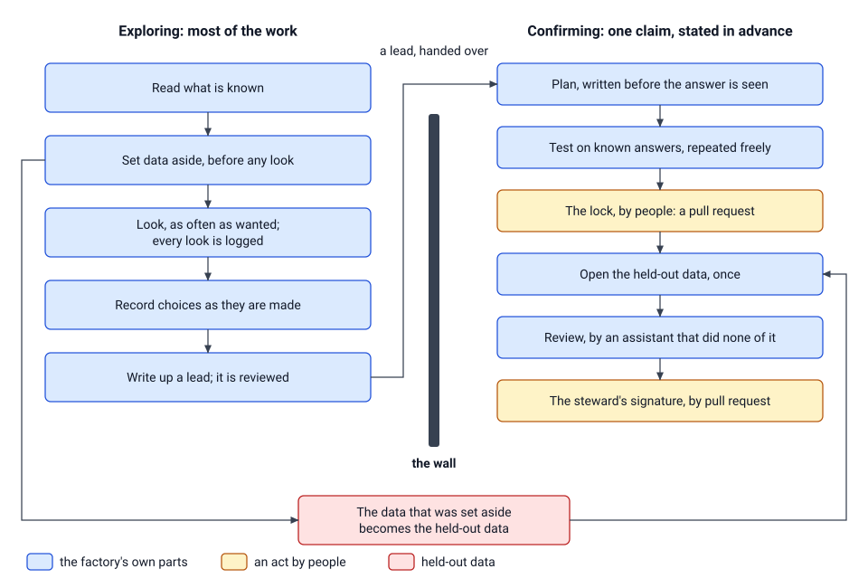

# Science Factory

A science factory tests a scientific claim the honest way: the plan is written and locked before anyone opens the fresh data that will check it. AI agents do the labor (exploring, building the method, reviewing, drafting what was learned), a tool with no language model in it keeps the order of events, and two acts stay with people: locking the plan, and signing the finding.

It is for an Earth scientist who wants a result that holds up, and for whoever must decide whether to trust it. It runs end to end on a synthetic record whose answer is known. No real study has been locked or signed with it yet.

## See it work

You need `git` and [`uv`](https://docs.astral.sh/uv/). From a fresh clone:

```
uv run tools/check_factory.py
uv run tools/sf.py selftest
uv run examples/stand-alone/run.py
```

The first says the factory's definition is valid (a second). The second has the study tool attack itself and ends with `selftest: PASS` (about a minute). The third explores a small record, proposes the fresh data from a description of it, drafts what it learned, takes a study to its lock, and describes a second record as STAC and looks at it with DuckDB and a marimo notebook inside the fence; it ends with `stand-alone example: PASS` (about five minutes) and prints a scratch folder holding everything it made; nothing is left in the repository.

## How it works, in one paragraph

You say what you want to know and what you have already looked at. An agent explores freely. Before it looks, it proposes the data that will check the idea, from descriptions of the data only (dates, places, versions): the next release, a later period, another site, or a random part the tool sets aside. You approve that choice when the plan is locked, as a pull request on GitHub. The tool then opens the fresh data once and runs the locked analysis. A second agent that did none of the work reviews it, and the steward signs the finding, or does not, by another pull request.



## Where to go next

To use it, in this order:

1. [How it works](docs/HOW-IT-WORKS.md): the two ways of working, the stages, and why.
2. [Define your own factory](docs/CREATE-A-FACTORY.md): copy the definition, name it, validate it.
3. [Your first exploration](docs/FIRST-EXPLORATION.md), by hand or with an agent.
4. [Your first confirming study](docs/FIRST-STUDY.md), with the fresh data proposed and a real lock.
5. [Using it from Claude](docs/USING-IT-FROM-CLAUDE.md): ask the factory in plain words, from Claude Code or Claude Desktop.

To decide whether to trust it:

1. [What is enforced](docs/WHAT-IS-ENFORCED.md), and by what: the one statement of it.
2. [The review and attack register](docs/reviews/README.md): every review and attack, what each found, and what is owed.

Reference: [the words](docs/WORDS.md), [compared with Warp Factories](docs/WARP-COMPARISON.md), [proposals](docs/proposals/), [the rename history](docs/history/RENAMES.md).

## The layout

| Folder | What is in it |
|---|---|
| `factory/` | the definition: `factory.yaml`, the agents, skills, harnesses, runners, checks, benchmarks, templates and change log |
| `tools/` | the programs you run: `check_factory.py`, `sf.py` (a study), `explore.py` (an exploration), `fresh_data.py`, `stac.py` (data described as STAC), `openings.py` (the shared registry of openings), `knowledge.py`, `scorers.py`, `benchmark.py`, `check_roles.py`, `waiting.py` (what waits on a person), `factory_update.py` (a study repository's copy, updated), `report.py` (what a workspace did), `factory_server.py` (the factory from Claude) |
| `methods/` | the built-in method the trials and examples use |
| `compute/` | the contract any runner keeps, and its test |
| `openwiki/` | this repository's knowledge base, a wiki |
| `examples/` | inputs and recipes that make their runs fresh |
| `docs/` | the pages linked above |
| `.github/` | the checks, the request form and the labels |

The repository keeps no runs. Your own studies live in the repository where your science lives.

A personal open-source project; Apache License 2.0.
