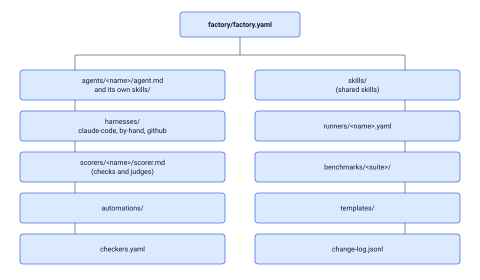
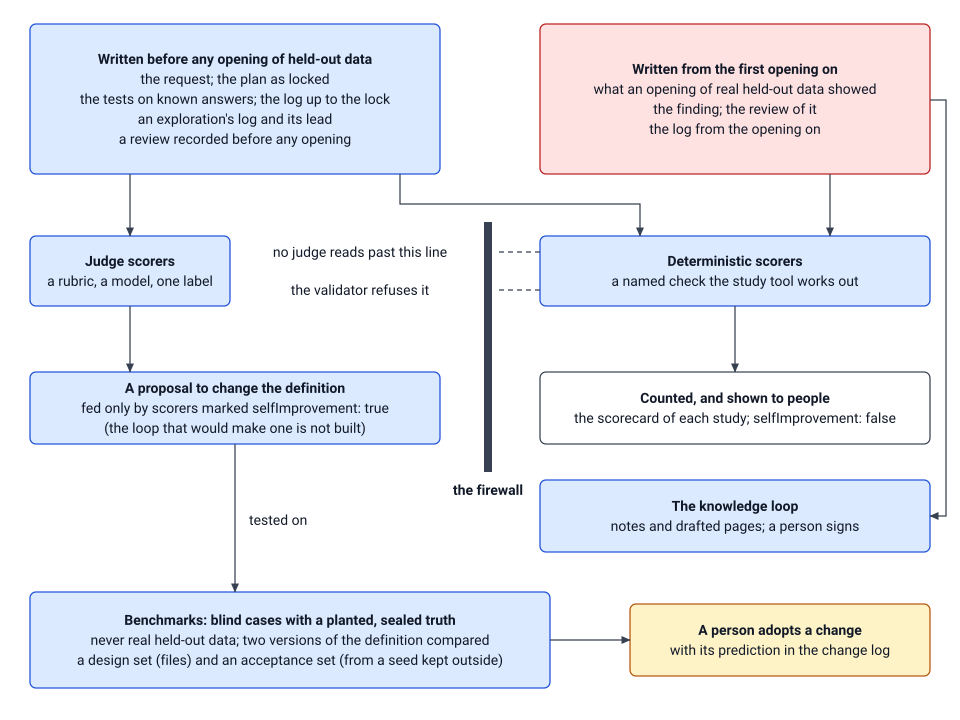

# Define your own factory

A factory is defined as code: the folder `factory/`, rooted at `factory.yaml`, says which agents exist, which stages a study passes through and what ends each, what starts an agent, how the factory is measured, and what may never feed a change to it. A change to the factory is a pull request to that folder, and a tool says whether the folder is valid. This page starts you in five steps, then is the reference for every file and key. What a tool enforces is in [WHAT-IS-ENFORCED.md](WHAT-IS-ENFORCED.md).

## Start in five steps

One layout, for every real study: **the repository where your science lives holds its own copy of `tools/`, `factory/` and, if you use the built-in method, `methods/` and `examples/stand-alone/system-trial/`** (the shipped benchmarks name that plan; drop both benchmarks if you drop it). The GitHub workflow runs the tools from there, the lock binds them from there, and the verification reads the repository name from that copy of the definition.

1. **Get the tools.** Clone this repository, run the three commands of the README to see that it works on your machine, and note the commit.
2. **Copy and name the definition.** Copy `tools/`, `factory/`, `methods/` and `examples/stand-alone/system-trial/` into your repository. In `factory/factory.yaml` set `name`, `alias`, `version`, the `home` block, and `repository:` under both acts to your repository's owner/name on GitHub.
3. **Validate it**, from your repository: `uv run tools/check_factory.py`. Put that and `uv run tools/check_factory.py --summary git:HEAD^:factory factory` in your checks.
4. **Protect the branch** and install the two acts by people, once, by the checklist in [factory/harnesses/github/README.md](../factory/harnesses/github/README.md). The same page says how to make the labels and the Project board.
5. **Run the system trial** ([FIRST-STUDY.md](FIRST-STUDY.md)): every stage on a blind test case whose answer nobody knows until after the opening. One right verdict on a kind case is a first sign, not proof; the blind test of the system (below) is the wider measure.

## The definition tree



The path is the name: an agent is called what its folder is called, a runner what its file is called.

| Path | What it is | Read by |
|---|---|---|
| `factory.yaml` | the root: the schema version, identity, defaults for agents, the stages and who does each, the two acts by people, the runner contract | `sf.py` (the stages, the acts); `check_factory.py` (all of it); people (the blocks marked for people) |
| `agents/<name>/agent.md` | one agent: its harness, model and runner, what it may call, must never see, reads, writes and hands on, in front matter; its instructions in the body | a harness; the validator; the lock (the declared models) |
| `agents/<name>/skills/<skill>/` | a skill that agent alone uses | that agent; the lock, by checksum |
| `skills/<skill>/SKILL.md` | a skill two or more agents use (`read-what-is-known`, `propose-fresh-data`) | the agents that name it; the lock, by checksum |
| `harnesses/<name>/` | what starts an agent (`claude-code`, `by-hand`), and what carries the two acts as pull requests (`github`) | you, or a workflow; the validator |
| `runners/<name>.yaml` | where a job computes, and how it keeps the job contract; `local` is built | people; the validator |
| `scorers/<name>/scorer.md` | one check of a study or an exploration: worked out by the tool, or a judge (a rubric for a model); an overclaiming check names its `phrases.yaml` beside it | `sf.py scorecard`; `explore.py`; `scorers.py` |
| `benchmarks/<suite>/` | a blind test suite | `benchmark.py` |
| `automations/<name>/automation.md` | what would start work without a person; declared, not wired | the validator |
| `templates/` | the request, a commented analysis plan, the kinds of question, the checklist for bringing a pipeline in | you copy them |
| `checkers.yaml` | the checkers `knowledge.py check-drafts` will run, each pinned by checksum | `knowledge.py` |
| `change-log.jsonl` | every change to the definition, with its prediction and what it did | people; written by `sf.py log-change` |

The work is not in the definition. `studies/`, `explorations/`, `record/`, `knowledge-queue/` and the records beside the studies live in your repository and are made by the tools. The definition is one folder, not the top of the repository, so that it can be copied in, reviewed as one thing and bound by one checksum.

## `factory.yaml`, key by key

**Read by the study tool.** Changing these changes what the tool does.

| Key | Meaning |
|---|---|
| `schemaVersion` | the form of the files; today `science-factory/v1alpha1` |
| `version` | the content of this definition; bump it with every change, and record the change with `sf.py log-change` |
| `procedure.stages[].id`, `done_by`, `done_when`, `does` | each stage's name; who does it (agents, or the word `people`); the checks that end it; one sentence shown at it |
| `procedure.acts_by_people.lock.opening_without_verification` | `refused` (the default) or `allowed-with-a-reason`: whether a person may open fresh data on a lock GitHub could not be asked about |

The checks a stage may name: `started`, `plan-complete`, `tests-pass`, `rehearsals-pass`, `locked`, `openings-complete`, `finding-attached`, `reviewed`, `steward-decided`, `notes-resolved`, `closed`.

**Read by the validator.**

| Key | Meaning |
|---|---|
| `agentDefaults` | the harness, model and runner an agent gets when its file names none |
| `procedure.coordinator` | the agent that follows `sf.py status` and starts the others |
| `procedure.agents` | what each agent does, in a sentence its file quotes word for word |
| `procedure.acts_by_people` | the lock and the signature: `who`, the `command` no agent may call, the `route` (`pull-request` or `practice`), and for a pull request the `harness`, `protected_branch`, `approvals`, `repository` (owner/name), `merge_methods` (`merge`, `squash`; never a rebase), `opening_needs` and `shows` |
| `procedure.so_what` | a person's answer to a reviewed lead: `who`, the `command` no agent may call, the `route` (`comment` on the platform, through a `harness` and for a `repository`, or `practice`) and the four `answers` |
| `where_it_runs`, `runner_contract.keys` | runner files, and the twelve keys every runner fills in |

They must be exactly the stages `done_by: people`. A factory declares both acts the same way; a factory whose acts are `practice` is valid, and every study under it is practice.

**Read by people**, stating the design, each saying what does hold it: `product`, `home`, `procedure.study_kinds`, `procedure.request` (with `fit_note`, the intake step of the skill `note-the-fit`), `procedure.people`, `procedure.separations`, `procedure.rules_for_people`, `measure`. Unknown keys, and keys given twice, are refused everywhere.

## Agents, skills and harnesses

**An agent file** is front matter, then instructions. `description` is one sentence. `harness`, `model` and `runner` fall back to `agentDefaults`; the model is a concrete name the harness lists, never `auto`. Then the permissions: `may_call` (commands as `tools/<tool>.py <command>`, skills as `skill:<name>`, agents it may start as `role:<name>`), `must_never_see` (in words, and as `path:<pattern>` where a harness can refuse it), `reads`, `writes` (patterns; every agent that writes has `record/<name>/*.md`) and `hands_on`.

**What holds an agent to its file.** The validator holds the files to each other: every command is one its tool has, no agent may call an act by people, the review agent may call nothing that does the work, each stage's command is in the file of the agent it is given to, a paragraph an agent file shares with a skill is the same words in both, and every command a file shows parses under the tool's options and passes `--model`. A harness holds an agent to its file while it works. Without a harness the file is instruction.

**Skills.** A skill two or more agents use is in `skills/`; one agent's own is in that agent's folder. A skill is a procedure with any script beside it and no facts about a dataset. Methods for a kind of data belong to the repository where that science lives; the factory ships one built-in method so its own stages can be exercised.

**Promoted methods: tools grow with use.** `explore.py promote` turns a look's script into `methods/<name>/`: the script, the exploration's runs of it as known-answer cases (inputs and outputs), the agent's README (what it computes, on what inputs, known limits), a generated `known_answer_tests.py`, and `method.json` with where it came from and every checksum. It is a change to the factory: the validator refuses it until a change-log record names `methods/<name>` with a prediction. A plan that binds a promoted method must run its `known_answer_tests.py` as a rehearsal, and the study tool refuses the study's tests and lock until that rehearsal has passed on the code as it stands.

**Harnesses.** `harnesses/claude-code/`: `render.py` writes the files Claude Code reads and fails on drift (`--check`); `allow.py` is the per-call check; `run_role.py` starts one agent in a fresh context and keeps its task and answer in `record/<role>/`. `harnesses/by-hand/as_role.py` asks the same check for one command. `harnesses/github/` starts no agent: it carries the two acts. None has run under its platform.

**The model is declared, not proven.** An agent passes `--model`; the tool writes it into the event and refuses an agent's event without one. The lock records the models the agents declare and the models the log recorded.

## Runners

A runner is where a job computes: this machine, a cluster scheduler, a cloud batch service, a platform beside the data. Each is a file in `runners/` with a status, a `contract` table of the twelve keys, and its open questions. Only `local` is built, and the study tool runs every command on the machine it is called on. The contract and its proof are [compute/README.md](../compute/README.md) and `compute/adapter.py`.

## Checks, judges, and the outcome firewall

A scorer is one file in `scorers/`, of one of two kinds. A **check** names a test the study tool works out from the log (`sf.py scorecard`); every study gets every one, and one that cannot be judged yet says `pending`. Nine ship for studies: `chain-of-custody`, `plan-adherence`, `opening-discipline`, `no-failed-opening`, `lock-committed`, `independent-review`, `acts-by-people`, `notes-curated` and `overclaiming-in-findings`; one, `overclaiming-in-leads`, applies to explorations and `explore.py` works it out. The two overclaiming checks read the phrases in `scorers/overclaiming-in-leads/phrases.yaml`, a list the factory edits (a pattern, why, and optionally `when: not-supported` or `unless`), and warn, never block: a check may say `warn`. A **judge** is a rubric for a model, with `labels`, a `passingScore`, a `samplingRate`, the `model` and the `agents` it scores. Three ship: `exploration-owns-its-count`, `review-finds-holes`, `plan-is-clear`. In a first trial, real-model agents judging six packets by hand, two runs each, matched the key on five, and on the sixth found a fault in the case itself; the Claude Code path (`scorers.py judge`) has not run. A packet names no place outside itself, `JUDGE.md` asks for `verdict.yaml`, and `scorers.py record` reads that file, writes the verdict beside the packet and moves the answer out of it.

Every scorer declares what it `reads`, from a fixed list split at the first opening of fresh data:

| Written before any opening | Written from the first opening on |
|---|---|
| `request`, `plan`, `known-answer-tests`, `code`, `pre-lock-log`, `exploration-log`, `lead`, `review-before-opening`, `transcript-before-opening` | `opening-outcome`, `finding`, `post-opening-log`, `review-after-opening`, `transcript-after-opening` |

**The firewall.** What a real opening showed must never reach anything that changes how the next opening is run, or the factory would drift toward agreeing with the claims it is given. So the validator refuses a judge that reads the right-hand column, `selfImprovement: true` on any scorer that reads it, and a benchmark case that is real fresh data. Outcomes may still be counted and shown to people, and they feed the knowledge loop. `tools/scorers.py` builds a judge's packet from exactly the declared material, each file by a checksum recorded before any opening.



## Benchmarks: the blind test, as suites

A suite (`benchmarks/<suite>/suite.yaml`) has cases (each a sealed, planted truth on synthetic or real sampling, never real fresh data), configurations (versions of the definition, by path or git ref), repetitions, and a comparison stated before anything runs. `uv run tools/benchmark.py run --suite factory/benchmarks/built-in-gain` runs six sealed cases twice under two configurations (the definition against itself) and ends with the comparison; the expected answer is `NO DIFFERENCE BEYOND NOISE`. Runs are paired, and only pairs where the two differ count, by an exact sign test.

The **design set** keeps its cases as files. The **acceptance set** keeps none: its cases are made when it runs, from a seed that whoever keeps the set gives in `SF_ACCEPTANCE_SEED`; without it the tool refuses. On GitHub that seed is an environment secret with a required reviewer, so only the job that accepts a change sees it. `methods/gain/system_trial.py blind-test` is the same driver on one definition.

## Automations

An automation says what would start work without a person: `triggers`, the `stage` it would start (only one agents do before the lock), and its instructions. Two are declared, a new data release and a signed page past its date. Neither is wired; on GitHub each would be an Actions trigger (`on: schedule`, or `on: issues` with the label `data-release`) that opens a request from the issue form.

## Validate a definition

```
uv run tools/check_factory.py
uv run tools/check_factory.py --summary git:HEAD^:factory factory
uv run tools/check_factory.py --checksum
uv run tools/check_factory.py --selftest
```

Three results: `valid` (exit 0), `invalid` (exit 1, each broken rule printed with its name) and `not validated` (exit 2, which is never a pass). The rules are **form**, **references**, **roles** (every rule of `check_roles.py`), **acts**, **skills**, **firewall**, **acceptance**, **automations** and **methods** (a promoted method beside the definition is whole, unchanged and in the change log). `--summary OLD NEW` says in plain words what a change does, the acts by people and agents' permissions first.

## What the lock binds

The plan, the code, the request, the receipts of the tests, the proposal of the fresh data, and the definition: the checksum of the whole tree (but the change log), its version, the checksum of `tools/`, each agent's declared model and harness, and each skill by checksum. A definition changed between the lock and the opening blocks the opening; the remedy is a new lock.

## What a file can change, and what needs code

By editing `factory.yaml` you can add, remove or reorder stages built from the checks above, change who does a stage, and allow or refuse an opening without verification. By adding or removing scorers you choose the checks and write judges of your own. By editing an agent's file you change what it may do, and the summary makes that hard to miss. A new kind of check, study, decision rule or material needs a change to the tools, with a self-test that fails without it.

## Measure and change

The scorecard, the judges, the benchmarks and the notes say how a factory is doing. A change is a pull request: `sf.py log-change` records the problem, the change and its prediction before it is tried, and what it did afterwards. Nothing is adopted automatically. The intended rule for adoption, which no tool enforces yet, is a pass on the acceptance set. On GitHub, tag each definition version and give it a release, beside the change log.

## Compared with Warp Factories

The layout follows [Warp Factories](https://docs.warp.dev/factories/) wherever the meaning is the same, so someone who knows it finds their way here in a minute. It is our own schema, read by our own tools, and it differs where science differs from software: permissions in every agent file, stages ended by checks a tool evaluates, two acts no agent may make, scorers that declare what they read, and a firewall between outcomes and improvement. [WARP-COMPARISON.md](WARP-COMPARISON.md) has the reading, concept by concept.
