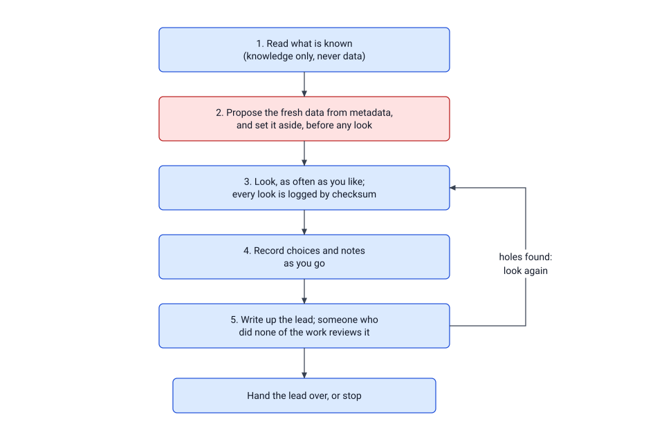
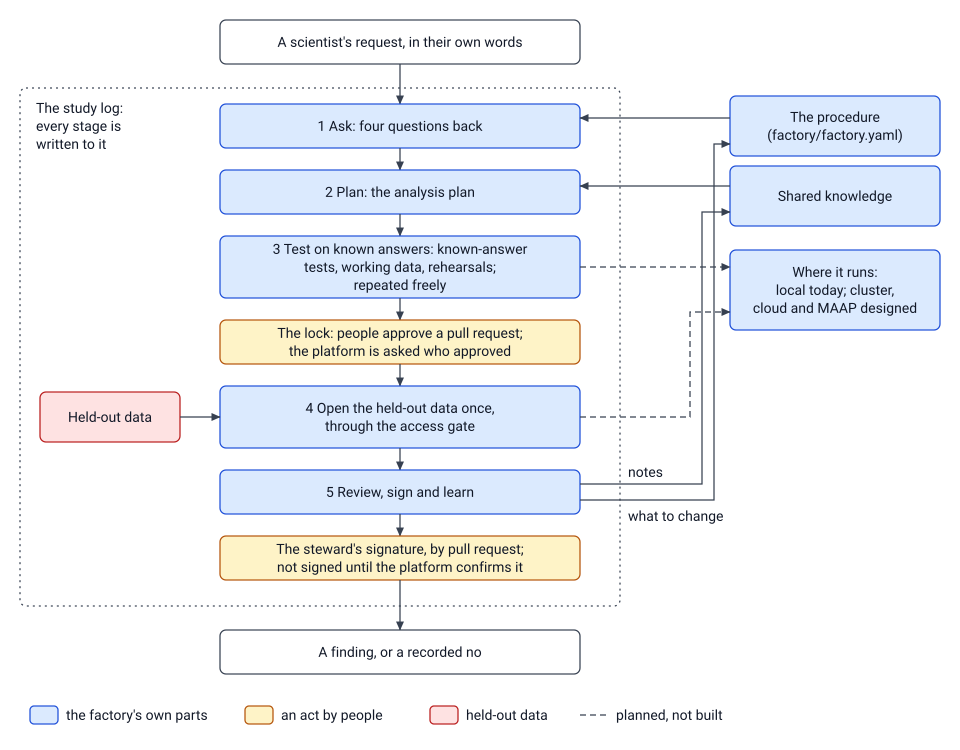
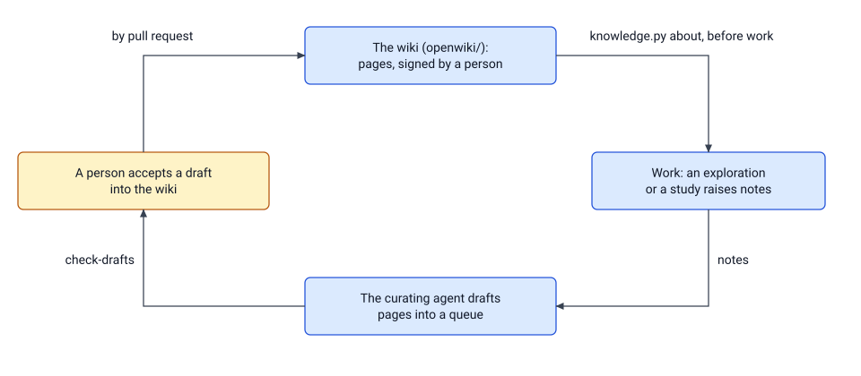

# How it works

A scientist works in two ways, and most days in the first. **Exploring** is looking at data to find out what is there. **Confirming** is testing one claim, stated in advance, on data you have not looked at. Both are real science. The trouble starts only when a result found the first way is reported as if it came from the second. The factory builds both ways, keeps a wall between them, and lets agents do the labor on both sides.

What a tool enforces, and what rests on people or on instruction, is set out in one place: [WHAT-IS-ENFORCED.md](WHAT-IS-ENFORCED.md). This page says how the work goes.

## Fresh data, and who chooses it

You do not have to bring "held-out data". Tell the factory what you have already looked at. An agent reads only descriptions of the data (dates, places, versions, counts, never the values) and proposes what could check your idea independently: wait for the next release, take a later period, try a site you have not touched, or keep a random part unopened. It writes down why that data suits the question, what would make it unfair, and how large a test it allows. You change or approve the proposal, and it is locked with the plan. The check then runs once. The tools call this fresh data held-out data, and nobody opens it before the lock.

| You might say | Known as | Suits | Unfair when |
|---|---|---|---|
| wait for the next release | re-validation on a new version | a claim about a product | the release reprocesses the old data too |
| wait for next year's data, or use a later period | the split-sample test | a record that keeps growing | a sensor, a method or the climate changed between the periods |
| try it on a basin we have not touched | the proxy-basin test | whether a method travels | the basin differs in a way the idea does not cover |
| keep a random part unopened | a random hold-out | many similar items, nothing to wait for | the items sit close in time or space to the ones explored |
| score the forecasts later | prospective testing | predictions | the forecast is revised after it is issued |

A random set aside is drawn by the tool from a seed it makes, so nobody chooses the members. It is the weakest of these: neighbouring sites and times share their errors, so a random part of one record checks less than it seems.

## Exploring: most of the work

This is what you do with a new dataset or a result that looks odd: plot it, compare it with another record, try a method, see where it breaks, change it, look again. Nothing in that loop needs to be slowed down, and an agent is at its most useful inside it. It produces an understanding of the data, pitfalls written down as notes, a method (a look script that proved useful can be promoted to one, with its runs as known-answer tests), and a **lead**: something that looks true and is worth testing. It cannot produce a tested claim, because every choice made after looking was made knowing how the answer would move.

The one rule is to say that it was exploring. The exploring tool (`tools/explore.py`) makes that easy in five steps:

1. **Read what is known.** Only knowledge is read first, never data: where the boundary of the fresh data should fall (a change of processing, a release) is a fact about the data, and it comes from a page.
2. **Set the fresh data aside.** The agent proposes it from metadata (`tools/fresh_data.py`), and the exploration starts by setting exactly that aside. Everything else is working data.
3. **Look, as often as you like.** Every look is a script run through the tool, logged with its inputs and output by checksum, with any figure it draws. A look that reaches for what was set aside is refused.
4. **Record choices and notes as you go.** Each choice is logged with its alternatives, and the log keeps how many looks had run when it was written down.
5. **Write up the lead, have it reviewed, and ask a person so what.** The lead says what looks true, how many things were tried, and which choices would change it. A reviewer who did none of the work picks holes in it first. Then a person who knows the field answers: worth confirming, try this instead, not interesting, or it needs an expert. Only `worth-confirming` lets it go to a confirming study. A lead is never a finding.

## Confirming: when a claim is to be signed

When a lead is to become a finding that others rely on, it is tested once on the fresh data. There are five stages, and the two acts by people, the learning and the close are steps of their own, nine in all:

| Stage | What happens |
|---|---|
| 1. Ask | You write a request in your own words (`factory/templates/request.md`, or the issue form on GitHub). The coordinating agent answers with a fit note: how well the question suits agents and what it will need from you, as advice. The analysis agent asks four questions back, and the study starts with the request bound to it by checksum. |
| 2. Plan | The analysis agent searches the wiki for anything that already answers or limits the question, reads only metadata, proposes the fresh data, and writes the analysis plan: what is estimated, on which data, and what result counts for or against the idea. |
| 3. Test on known answers | The plan check, the known-answer tests (synthetic data with the truth put in, including cases where the idea is false and cases right at the smallest difference you care about), the working data and the rehearsals of the opening, repeated freely. |
| The lock | People approve the plan, the code and the choice of fresh data together, by approving and merging a pull request that carries the evidence in plain words and every figure the work drew, for them to look at themselves. |
| 4. Check once, on fresh data | The tool fetches the fresh data and runs the locked analysis on it, once. It will not do so for the agent that ran the tests. |
| 5. Review, sign and learn | The finding is written from the run's own records, and the tool adds who did each step, from the logs. A review agent that did none of the study checks every number. The steward signs the finding, or records the decision not to, by a second pull request. Notes go into the wiki through a queue of drafts, and what should change goes into the definition. |

Every step is written to a **study log** that is only ever added to. Once it is committed and its fingerprints are posted outside the workspace, a later edit to it shows.

## What is learned goes back

Every piece of work raises notes: something missing or wrong in the data or the knowledge, with evidence. When an exploration ends or a study closes, the curating agent drafts pages from the notes into a queue of drafts, and a person decides what joins the wiki. A draft is never a finding, and a page is signed only by a person's own line in it. The next question finds the page, marked as a draft or as signed.

## The wall between them

Data that was used to explore cannot be used to confirm what the exploring found. That is the whole wall:

- The plan names what you have seen and what will check it; only the tool fetches the second, once.
- If the result is inconclusive, that is the result for that data; the next chance is the next fresh data.
- After the opening, a review can send back the write-up, never the analysis. A change to the analysis after the opening makes the study an exploration again, and it is recorded as one.

When nothing can be kept unopened, because there is one record and all of it has been seen, the honest alternative is to hide the answer and not the data: shift the quantity of interest by an amount nobody in the analysis knows, finish every decision, then remove the shift. That is blind analysis. It is not built here. When data keeps arriving and the question is whether something has changed, the test has to be one that may be read as each batch comes in; that is the watching study, proposed in [proposals/watching-studies.md](proposals/watching-studies.md) and not built.

## Why it is built this way

A factory, in the sense the software industry settled on in 2026, is a loop with a sensor: intent goes in, agents do the work, and something outside the agents says whether the work is right. A software factory's sensor is its tests. A knowledge factory's sensor is agents reporting what they found missing or wrong. For science the sensor is experiments on data, and the main consequence is that the factory may iterate freely against some experiments and must never iterate against others.

| Step | In flight software | Here | Repeat freely? |
|---|---|---|---|
| Plan check | static analysis | the plan is complete and well formed | yes |
| Known-answer tests | software in the loop | synthetic data with the truth put in | yes |
| Working data | hardware in the loop | the record you have already seen, and rehearsals of the opening | yes |
| Fresh data | the flight-like testbed | data nobody has looked at, opened by the tool | once |

A testbed is scarce because it is one machine; fresh data is scarce because every opening spends the evidence it can give. Six rules follow that software factories do not have:

- **A rule must be able to fail, measured where it matters.** Before the lock, every decision rule must show on the known-answer tests that it refutes the idea when the idea is false, and that it rarely confirms or refutes wrongly right at the smallest difference that matters. The people locking see each rate beside its threshold.
- **Metadata is defined by a test, not by a list.** What may be read before the lock is anything that cannot move the answer whatever the fresh values turn out to be: pass times, quality flags, site lists, release dates.
- **The opening is rehearsed** on working data, end to end, before the lock.
- **One window, one opening.** A second study of the same subject and an overlapping window is marked exploratory, whatever it finds. That is what makes inconclusive a final answer.
- **The two acts by people are made where a person is a person.** On one machine, where agents and people share one account, a name typed on a command line cannot say who acted. So the lock and the signature are pull requests on GitHub, and the tools call an act verified only on GitHub's own answer.
- **Set the fresh data aside first, then explore.** Most science starts with no hypothesis. Exploring gets its own tool, which sets data aside before it looks at anything.

None of this is new. Clinical trials finish the analysis plan before the data is unblinded. Particle physics uses blind analysis. Preregistration writes the plan down before the outcomes are seen. Hydrology has the split-sample test. Earth observation validates a product by independent means, again at each new version. Machine learning learned that a test set checked again and again while a method is tuned stops being a test. Formal locking is still rare in Earth science, so the factory does not ask it of every piece of work: only of claims that are to be signed.

| | Exploring | Confirming | Software |
|---|---|---|---|
| Revise after review | yes, freely | only before the lock | yes, freely |
| What a person approves | nothing is locked | the plan, the code and the fresh data, before the opening | the change, then the merge |
| What ends it | a lead, a note, a method or a stop | a signed finding or a recorded no | a merged change |
| What is scarce | attention | fresh data | time |

## Sources

- Nosek, Ebersole, DeHaven and Mellor, "The preregistration revolution", PNAS 2018: https://pmc.ncbi.nlm.nih.gov/articles/PMC5856500
- MacCoun and Perlmutter, "Blind analysis: Hide results to seek the truth", Nature 2015: https://www.nature.com/articles/526187a.pdf
- Klemeš, "Operational testing of hydrological simulation models", 1986, as described in Nicolle and others, HESS 2021: https://hess.copernicus.org/articles/25/5013/2021/hess-25-5013-2021.pdf
- The CEOS validation hierarchy, Land Product Validation subgroup: https://lpvs.gsfc.nasa.gov
- NASA Earthdata, data maturity levels: https://www.earthdata.nasa.gov/learn/earth-observation-data-basics/data-maturity-levels
- Dwork and others, "Generalization in adaptive data analysis and holdout reuse", 2015: https://arxiv.org/abs/1506.02629
- "Registered Report for climate research", editorial, Nature Climate Change 2024: https://www.nature.com/articles/s41558-024-01932-4
- LangChain, "How to Build a Knowledge Factory for AI Agents": https://www.langchain.com/blog/knowledge-factory
- Warp's documentation of factories, as compared in [WARP-COMPARISON.md](WARP-COMPARISON.md)
