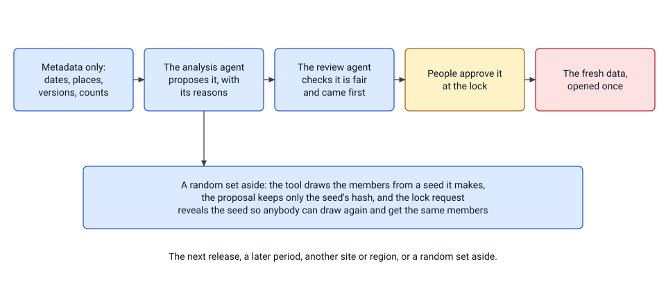

# How it works

**Exploring** is looking at data to find out what is there. **Confirming** is testing one claim, stated in advance, on data you have not looked at. Both are real science; the trouble starts when a result found the first way is reported as the second. The factory builds both, keeps a wall between them, and lets agents do the labor. What a tool enforces is in [WHAT-IS-ENFORCED.md](WHAT-IS-ENFORCED.md).

## Fresh data, and who chooses it

Say what you have already looked at. An agent reads only descriptions of the data (dates, places, versions, counts, never values; by default a STAC catalog, the open standard for describing data in time and space) and proposes what could check your idea: why it suits, what would make it unfair, how large a test it allows. You change or approve it, and it is locked with the plan. The tools call it held-out data; nobody opens it before the lock.

| You might say | Known as | Suits | Unfair when |
|---|---|---|---|
| wait for the next release | re-validation on a new version | a claim about a product | the release reprocesses the old data too |
| use next year, or a later period | the split-sample test | a record that keeps growing | a sensor, method or the climate changed between periods |
| try a basin we have not touched | the proxy-basin test | whether a method travels | the basin differs in a way the idea does not cover |
| keep a random part unopened | a random hold-out | many similar items, nothing to wait for | the items sit close in time or space to those explored |
| score the forecasts later | prospective testing | predictions | the forecast is revised after it is issued |

A random set aside is drawn at the opening from the merge commit GitHub makes when a person merges the lock request, so nobody chooses the members; an exploration cannot set one aside. It is the weakest kind: neighbouring sites and times share their errors, so a random part of one record checks less than it seems. Across factories, every verified opening is written by the workflow into a shared registry of openings (a STAC catalog in a repository of its own), and data it records as opened before a lock is refused as fresh.

## Exploring: most of the work

Plot, compare, try a method, see where it breaks, look again: nothing here is slowed down, and an agent is most useful inside it. It yields notes on pitfalls, methods (a useful look can be promoted, its runs becoming known-answer tests), and **leads**: things that look true and are worth testing. Never a tested claim, because every choice made after looking knew how the answer would move. `tools/explore.py` keeps the record in five steps:

1. **Read what is known**, never data: where the fresh data's boundary falls (a change of processing, a release) comes from a page.
2. **Set the fresh data aside**, exactly as the agent proposed it from metadata (`tools/fresh_data.py`). The rest is working data.
3. **Look, as often as you like.** Each look is a script or a notebook run through the tool, logged by checksum with any figure it draws; one that reaches for what was set aside is refused. A notebook can also be worked in by hand inside the fence, and is then run once as a look before anything it showed is quoted.
4. **Record choices and notes as you go**, each choice with its alternatives and how many looks had run when it was written.
5. **Write up the lead, have it reviewed, ask a person so what.** The lead says what looks true, how many things were tried, and which choices would change it. A reviewer who did none of the work picks holes in it; then a person who knows the field answers worth confirming, try instead, not interesting, or needs an expert. Only `worth-confirming` sends it on. A lead is never a finding.

## Confirming: when a claim is to be signed

A lead that others will rely on is tested once on the fresh data, in five stages around the two acts by people:

| Stage | What happens |
|---|---|
| 1. Ask | Your request in your words (`factory/templates/request.md`, or the issue form). The coordinating agent gives a fit note, as advice: how well it suits agents, what it needs from you. The analysis agent asks four questions back; the study starts with the request bound by checksum. |
| 2. Plan | The analysis agent reads the wiki, reads only metadata, proposes the fresh data, and writes the plan: what is estimated, on which data, what counts for or against. |
| 3. Test on known answers | The plan check, known-answer tests (synthetic data with the truth put in, false ideas and cases at the smallest difference you care about among them), the working data and rehearsals of the opening, repeated freely. |
| The lock | People approve plan, code and fresh data together by merging a pull request carrying the evidence in plain words and every figure. |
| 4. Check once | The tool fetches the fresh data and runs the locked analysis on it, once, and never for the agent that ran the tests. |
| 5. Review, sign, learn | The finding is written from the run's records, with who did each step. A review agent that did none of the study checks every number. The steward signs, or declines, by a second pull request. Notes go to the wiki as drafts; what should change goes into the definition. |

Every step goes into a **study log** that is only added to; once committed, with its fingerprints posted outside the workspace, a later edit shows.

## What is learned goes back

Work raises notes (something missing or wrong, with evidence). The curating agent drafts pages from them into a queue, and a person decides what joins the wiki. A page is signed only by a person's own line in it.

## The wall

Data used to explore cannot confirm what the exploring found. Only the tool fetches the fresh data, once, and inconclusive is the result for that data. After the opening a review can send back the write-up, never the analysis; changing the analysis makes the study an exploration again, on the record.

When nothing can be kept unopened, the honest alternative is blind analysis (shift the quantity by an amount nobody knows, decide everything, remove the shift); it is not built here, nor is the watching study for data that keeps arriving ([proposals/watching-studies.md](proposals/watching-studies.md)).

## Why it is built this way

A factory is a loop with a sensor: intent goes in, agents work, and something outside them says whether the work is right. For software the sensor is its tests; for science, experiments on data, some repeatable freely and some never.

| Step | In flight software | Here | Repeat freely? |
|---|---|---|---|
| Plan check | static analysis | the plan is complete and well formed | yes |
| Known-answer tests | software in the loop | synthetic data with the truth put in | yes |
| Working data | hardware in the loop | the record already seen, and rehearsals of the opening | yes |
| Fresh data | the flight-like testbed | data nobody has looked at, opened by the tool | once |

A testbed is scarce because it is one machine; fresh data, because every opening spends its evidence. Six rules follow:

- **A rule must be able to fail where it matters.** Before the lock, known-answer tests show each decision rule refutes a false idea and rarely errs at the smallest difference that matters; the people locking see each rate beside its threshold.
- **Metadata is defined by a test:** anything that cannot move the answer whatever the fresh values are (pass times, flags, site lists, release dates).
- **The opening is rehearsed** on working data, end to end, before the lock.
- **One window, one opening.** A second study of the same subject and window is exploratory, whatever it finds. That makes inconclusive final.
- **The acts are made where a person is a person.** On one machine a typed name cannot say who acted, so the lock and signature are GitHub pull requests, verified only on GitHub's answer, asked where it is used.
- **Set the fresh data aside first, then explore.** Most science starts with no hypothesis.

None of this is new: preregistration fixes the plan before the outcomes, physics hides results, hydrology splits samples, Earth observation validates each product version independently, and machine learning learned that a reused test set stops being one. Formal locking is rare in Earth science, so the factory asks it only of claims to be signed.

## Where the person's part comes from

Six pieces come from our reading of Schwartz's ["Claude-shaped science"](https://www.anthropic.com/research/claude-shaped-science), a physicist's three months of science with Claude. Results were correct and unremarkable until an expert steered: every lead waits for a person's so what. Agents declare victory early, so a person must look at the plots and distrust "good agreement": the lock shows every figure and the overclaiming check flags such words. The best work suited the agents: a fit note comes first. Tools grew with use: a look can become a method. Credit should not pretend the person only typed: a contribution statement comes from the logs. The mistakes in carrying this over are ours.

## Sources

- Nosek, Ebersole, DeHaven and Mellor, "The preregistration revolution", PNAS 2018: https://pmc.ncbi.nlm.nih.gov/articles/PMC5856500
- MacCoun and Perlmutter, "Blind analysis: Hide results to seek the truth", Nature 2015: https://www.nature.com/articles/526187a.pdf
- Klemeš, "Operational testing of hydrological simulation models", 1986, as described in Nicolle and others, HESS 2021: https://hess.copernicus.org/articles/25/5013/2021/hess-25-5013-2021.pdf
- The CEOS validation hierarchy, Land Product Validation subgroup: https://lpvs.gsfc.nasa.gov
- NASA Earthdata, data maturity levels: https://www.earthdata.nasa.gov/learn/earth-observation-data-basics/data-maturity-levels
- Dwork and others, "Generalization in adaptive data analysis and holdout reuse", 2015: https://arxiv.org/abs/1506.02629
- "Registered Report for climate research", editorial, Nature Climate Change 2024: https://www.nature.com/articles/s41558-024-01932-4
- Schwartz, "Claude-shaped science", Anthropic, October 2026: https://www.anthropic.com/research/claude-shaped-science
- LangChain, "How to Build a Knowledge Factory for AI Agents": https://www.langchain.com/blog/knowledge-factory
- Warp's documentation of factories, as compared in [WARP-COMPARISON.md](WARP-COMPARISON.md)
