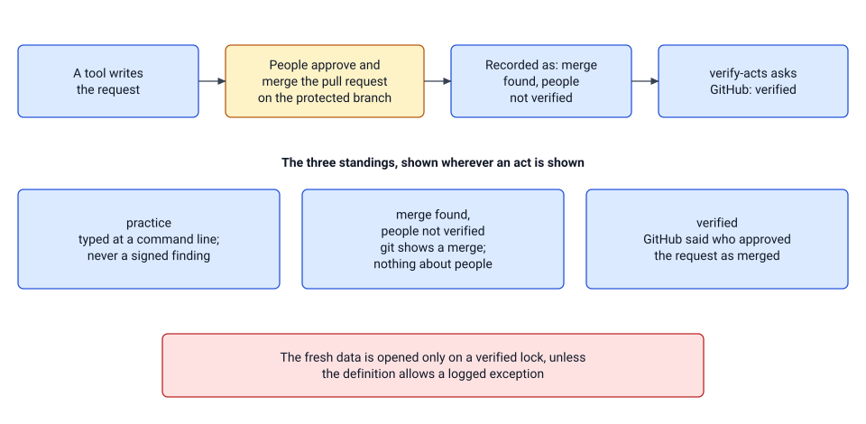

# What is enforced, and by what

The one statement of what the factory enforces; other pages link here. List 1 is what a tool enforces on any machine, 2 what holds only with the kernel fence or a harness's per-call check, 3 what people and GitHub hold, 4 what is only an instruction. Rows of lists 1 and 2 name their self-test (`uv run tools/<tool> selftest`, or a harness script's `--selftest`) and finding; the [register](reviews/README.md) names each finding's checks. R4's fixes are tested by their author only.

**Fresh data** is data nobody working on the question has looked at; the tools call it **held-out data**, and in an exploration **set aside**. An **act** is one of the two things only people do: the lock and the steward's signature.

**Lists 1 and 2 slow a careless agent and catch honest mistakes.** They are no security boundary against a determined agent, or person, sharing the user's account: a defence that matches patterns loses to the next spelling, and a name typed on a command line cannot say who acted. So the two acts rest on neither. Each is a pull request on GitHub, approved and merged on a protected branch, where GitHub decides who a person is; its standing is GitHub's answer, asked again wherever it is used. List 3 says what asking from this machine leaves to trust.

## The three standings of an act

A clone cannot prove that people acted, so the tools never say they did on local evidence. Every lock and signature has one of three standings, shown wherever the act is (`sf.py status`, the scorecard, `check-log`, the signature request, a finding's first line, the curation list), each place asking GitHub again.

| Standing | Rests on | Does not show |
|---|---|---|
| `practice` | typed at a command line (`--local-practice`) | anything about anybody |
| `merge found, people not verified` | git here finds a merge of the request on a branch with the protected branch's name, its manifest matching the files | that anyone approved, that there was a pull request, or that the branch is protected: a clone can make all of it, and an approvals file here is one anybody here can write |
| `verified` | GitHub, asked now where the standing is used (also the opening, the close, the requests, `sf.py verify-acts`), said the commit merged a pull request into the protected branch of the repository the definition names, approved on the request as merged by enough accounts other than its author, none a bot. `verify_acts.py` asks in its own process, with only the token in its environment, at api.github.com only, through no proxy the definition does not name, trusting the system's certificates, and records host, proxy and certificate file | that the approvers are the right people, or that the system's certificates and the Python that asked were not changed on this machine (list 3) |

A verification in the log is a note of what was asked and when, and decides nothing: with no token or network a merged act stands, now, as `merge found, people not verified`; where the log says GitHub once answered `verified`, status says "verified when last checked at <time>; not re-checked now". A study whose lock or signature is not `verified` when asked is "awaiting verification": unsigned in its status, record and finding's first line, and it does not close as a signed finding.

**No network.** `open-held-out --people-not-verified REASON` opens fresh data on a merge found with git when GitHub cannot be asked. It is refused unless the lock in `factory.yaml` says `opening_without_verification: allowed-with-a-reason` (shipped: `refused`), and always for an agent. The lock binds the definition and a changed one blocks the opening; the validator and the lock refuse a change to the acts by people unless a change-log record names it under a version no other acts used; the lock request says the exception in capitals. So allowing it is a change people see, approve and lock, not something typed at the opening. Where allowed, the reason is logged, the finding's first line says so, and the study stays unsigned until a verification succeeds. A GitHub answer that refutes the lock is never waived.

**The so what**, a person's answer to a reviewed lead (`worth-confirming`, `try-instead`, `not-interesting`, `needs-an-expert`), is a comment on the tracking issue, not a pull request. The acts guard something scarce (fresh data, a finding); the so what spends nothing, a lead it passes still meets people at the lock, and a comment is cheap enough for every lead while GitHub can say who wrote it. Standings: `practice` (typed); `comment recorded, person not verified` (written as `platform:github` by the workflow's `so-what` job, or by anybody with a file); `verified` (GitHub, asked where the standing is used: in the named repository, by that account, a user of it, unedited). A recorded `verify-so-what` is a note.

## 1. Enforced by the tools, on any machine

| # | What holds | Test (finding) |
|---|---|---|
| 1.1 | A typed lock or signature is refused unless it says practice; a practice study says so everywhere and never closes as signed. | `sf.py` (R2-05) |
| 1.2 | Nothing in the work tree, a logged verification included, makes an act more than `merge found, people not verified`; names handed to `--record-merge` are shown as handed, with their standing, never as approvers. | `sf.py`, `record_act.py` (R3-01, R4-15) |
| 1.3 | Without GitHub's answer, asked at the opening, no fresh data opens on a merged lock; the attempt is logged `not checked` and uses nothing up. A stand-in's answer in the tool's process is refused outside the self-tests. `--people-not-verified` is refused unless the definition allows it, and always for an agent. | `sf.py`, `verify_acts.py` (R3-01, R4-01, R4-03, R4-11) |
| 1.4 | A merge found with git is on the named branch's own line, reachable from what is checked out, with two parents and the request from the second, its manifest matching. An ordinary commit is refused; squash only where the definition lists it; rebase never. | `sf.py`: "no merge", "wrong branch" (R3-02) |
| 1.5 | A definition or `tools/` changed between lock and opening blocks the opening and says what changed. Checksums bind each file's bytes, bytecode included, its executable bit, and a symlink as a link. | `sf.py`, `check_factory.py` (R3-03, R4-02) |
| 1.6 | A plan, a bound file, or anything new Python could import beside one, changed after the lock, blocks the opening. Each test on fresh data opens once, logged before it fetches. | `sf.py`: the lock and opening checks |
| 1.7 | What a plan holds out goes on record when a tool first sees it. A changed block is refused until the coordinating step records a reason, which whoever ran the tests cannot; the lock shows every change, one with no record too. | `sf.py` (R2-06) |
| 1.8 | `tools/fresh_data.py` proposes from one metadata file, refused if any field is not metadata, and records each proposal beside the studies. A random set aside draws nothing when proposed: the opening draws it once, from the lock request's merge commit as GitHub confirms it then and the proposal's checksum; a seed or members file handed in is refused. In practice the draw comes from the practice lock's log entry and is marked as one that could be chosen. | `fresh_data.py`: "the proposing step opens one file to read, the metadata"; `sf.py` (R4-06) |
| 1.9 | An exploration sets aside exactly the proposal it names, and cannot start on a random set aside. A lock request refuses a proposal not on the record byte for byte, a random set aside drawn when proposed, or a window outside a proposed later period; it shows the proposal in words, and says so plainly when a plan names none. | `explore.py`: "a random set aside cannot be typed"; `sf.py`: "a proposal edited by hand after the tool wrote it is refused at the lock" (R4-06) |
| 1.10 | A study log rewritten and committed again fails the log check and blocks the opening; the merged request pins the log's head as it was. | `sf.py` (R3-05) |
| 1.11 | The study, exploring, fresh-data and knowledge tools refuse every command run from inside a look or a plan's step. | `sf.py`, `explore.py` (R1-04, R2-05) |
| 1.12 | A plan's command, and a look, run in a scratch copy with no log, in an environment the tool builds and the receipt names. A step that rewrites the plan or a log in its copy changes neither, and fails. | `sf.py` (R2-03) |
| 1.13 | A look gets the exploration's own files and the working data declared at its start, nothing else; one naming a folder, pattern, tilde path, variable or several paths in a word is refused; each is logged with inputs and output by checksum. A reviewer's `recheck --variant` runs on the same files and is logged nowhere. | `explore.py`: "a reviewer's variant of a look" (R1-01, R2-04) |
| 1.14 | Second line: what a look is given, prints or leaves is read for set-aside names and window dates, in the forms `tools/explore.py` lists; a hit refuses the look or spoils the exploration. | `explore.py` (R2-04) |
| 1.15 | A review is recorded only for the lead read, by checksum, from a reviewer named before the lead who did none of the work. | `explore.py` (R1-04, R2-07) |
| 1.16 | A decimal in a lead, in the listed forms, was printed whole by a cited look or stands in a listed wiki's page; a listed constant (1.96 and a few more) or a count may stand in method words. A plan sentence naming a look quotes only what it printed; other plan numbers are proposals, not checked. The summary is checked too. | `explore.py` (R1-08, R2-08, WR-F18) |
| 1.17 | A draft's source is an existing file, an https address with a host, or a doi; a draft carries no signature. | `knowledge.py` (R1-10, R2-12, SR-A5) |
| 1.18 | An agent's event names its model (`--model`) or is refused; names are matched whole; `platform:<host>` writes only a merged act and its verification. | `sf.py`, `explore.py` (R2-14) |
| 1.19 | Every tool and harness script restarts in a Python that reads no `PYTHON` variable, user site, start-up file, cached bytecode or its own folder, and loads its neighbours from source. Bytecode, a symlink, or a file in `tools/` that is not a tool, under `factory/` or `tools/`, is refused at the lock, the opening and before GitHub is asked. | `sf.py` (R2-09, R4-02) |
| 1.20 | The validator refuses an unknown key, a dangling name, a judge reading anything written after an opening, `selfImprovement: true` on a check that does, a pull-request act lacking harness, branch, approvals, repository or merge method, a rebase merge, an unknown `opening_without_verification`, bytecode, and acts by people that no change-log record names or that differ from acts under the same version. | `check_factory.py`: a case per rule (R4-11) |
| 1.21 | A judging packet holds what its scorer declares, each file by a checksum recorded before any opening (a plan's includes its bound code), nothing written after an opening, and no path outside itself, in its logs too. The verdict goes beside it and the answer file leaves it. | `scorers.py`: the firewall checks (R4-12) |
| 1.22 | The acceptance set of blind cases gives nothing without its seed, which is not in the repository. | `benchmark.py` |
| 1.23 | Every command shown in an agent file, a skill or AGENTS.md parses under its tool's current options and passes `--model` where an agent acts. | `check_roles.py` |
| 1.24 | No exploration ends as a lead, and none is handed over, without a person's `worth-confirming` on the lead as it stands after its latest review. Refused: an agent's so what; a typed one unless it says practice (the hand-over then says so); a comment not from a user of the named repository naming this lead, or one GitHub does not confirm at the hand-over, except in practice. A study that comes from an exploration (by hand-over, proposal or working data, however started) needs that `worth-confirming` at the lock request, the lock and the opening; on a merged lock, a comment GitHub confirms when the opening asks. | `explore.py`, `verify_acts.py`, `check_factory.py`, `allow.py`: the so what checks (R4-04, R4-05) |
| 1.25 | A lock request shows, as captioned pictures, every figure the looks kept (bound at the study's start) and the plan's steps declare; a signature request, the opening's. A declared figure not drawn fails its step, a changed one refuses the request; both manifests bind them. | `sf.py`, `explore.py`, `verify_request.py`: the figure checks |
| 1.26 | An attached finding says who did each kind of work, from the study's and its exploration's logs, with each agent's declared model and what the logs cannot show; a person is named as confirmed only on GitHub's answer asked then. A draft from work is refused without a **Who did what.** paragraph. | `sf.py`, `explore.py`, `knowledge.py`: the contribution checks (R4-15) |
| 1.27 | Leads, findings and reviews are read for the phrases of `scorers/overclaiming-in-leads/phrases.yaml` and numbers finer than their uncertainty (`confirms` unless the rules gave `supported`); each flag names phrase and line, at `lead`, `review` and `attach`, in status, the scorecard and the signature request. It warns, never blocks. | `sf.py`, `explore.py`, `check_factory.py`: the overclaiming checks |
| 1.28 | A fit note is complete or refused, and refused once the first look or test has run; status, the hand-over and the lock request show it or say there is none. It blocks no work. | `sf.py`, `explore.py`: the fit checks |
| 1.29 | A method is promoted only from a passed look, with its README's three parts, its runs as cases (under a release set aside, only runs on the working data as it stood) and every checksum; the validator refuses it changed or missing from the change log. A plan binding one needs a rehearsal running its tests; its tests, other rehearsals and lock wait until that rehearsal passed on the code as it stands. | `explore.py`, `check_factory.py`: "a promoted method" (R4-07) |
| 1.30 | A new release set aside binds the data as it stands. The proposal names a declared release and fixes the cut-off (the metadata's last date), with checksums where given. The start needs the cut-off, refuses working data with a later date or not the file described, and binds every working file. A look or recheck given a working file changed or new since the start, or any file with a date or month past the cut-off, is refused and logged. Dates are read row by row (the forms beside `read_date` in `tools/explore.py`); dated data with an undatable row is refused. No other exploration, by subject or by file, with or without a working window, explores past the cut-off, and its record must be the workspace's. | `explore.py`, `fresh_data.py`: the release checks (WR-F1, R4-07, R4-09) |
| 1.31 | A confirming study carries the release on: from the hand-over, the cut-off and working files' checksums of the exploration's start (an agent's own refused); without one, from a next-release proposal, binding the files given. The lock binds and states them, and refuses a window not starting after the cut-off or a plan naming a next release the start did not bind. The study's tests and rehearsals are refused on changed working data, or a bound file other than a Python script holding a date past the cut-off. The opening refuses working data changed since the lock; waits while the plan's last period has not ended by the UTC date (or the metadata expects the release later); logs the release's first and last dates and checksum; and does not analyse fresh data with a row on or before the cut-off, an undatable row, no date, or short of the window, that opening being used up. An exploration that set the release aside explored up to the cut-off, so a study from it is not exploratory on that account. | `sf.py`, `explore.py`, `fresh_data.py`: the cut-off checks (WR-0.15, R4-08, R4-10, R4-13, R4-14) |
| 1.32 | An update of a study repository's factory (`tools/factory_update.py`) is refused while a study is locked and not closed, unless a person carries it on its old version, which the pin records; a field changed on both sides to different values, lines that meet, a tool edited here and changed upstream, or a pin whose checksums are not the trees at its commit is refused, never merged silently. | `factory_update.py` |
| 1.33 | The factory server (`tools/factory_server.py`) runs only the eleven commands of its allow list (waiting, report, the definition's check, status and contribution of a study or exploration, fresh-data describe and propose, an exploration's start, and the registry's check), from its own `tools/`, never a workspace's; none is a person's act, a verification, an opening, a promotion, a change to the definition or a look. It refuses a `human:` or `platform:` name, an option typed inside a value, an argument no tool lists, a path with `..`, a hidden part or a link in it, a file written over, and a workspace whose definition carries code other than its own; it opens no file outside the workspaces, the wiki and its own `tools/` and `factory/`. What the commands it runs read is theirs, as on the command line. | `factory_server.py` |
| 1.34 | The command line, like the factory server, runs only its own package's code: `check_factory.py`, `check_roles.py`, `sf.py`, `waiting.py` and `report.py` refuse a definition, or a repository's tools, whose code (any `.py`, shell script, bytecode, executable or link) differs from their own, before loading or reading anything, unless a person passes `--use-workspace-code`, which is then said in capitals; no role may pass it. | `check_factory.py`: "the command line refuses to validate a definition whose tools or harness code are not its own"; `allow.py` |
| 1.35 | A proposal made from a STAC description reads only the fields a proposal may read, and refuses any other property or asset field (a measured value may hide there) unless it is named to be left unread, which the proposal lists; it binds the query (collection, time, box) and the fresh Items by ID and the checksums of their files, or the query alone when none is published, and the lock binds the proposal. A look is refused a file that is, by checksum, a set-aside Item's, wherever it sits, and a file of the declared working data that is no working Item's. The opening and `waiting`, once the dates say a release can be out, ask its catalog and wait while it lists no Items reaching the window's end, or cannot be asked. What `describe` writes validates against the STAC 1.1.0 and File Info schemas shipped in pystac, nothing fetched. | `stac.py`, `fresh_data.py`, `explore.py`: "an exploration set aside from a STAC description binds the Items"; `sf.py`: "a release proposed from a STAC description" |
| 1.36 | Parquet working data enters a look only after the fence has read its date columns with DuckDB in the tool's process, the row-group statistics first and every row in full: a file with a row inside the set-aside window or past a release's cut-off, a row with no readable date, or no date column is refused, and so is a set-aside site in a text column. The receipt records what was read and the file's checksum, and the copy a look is given must have that checksum. | `explore.py`: "a look is given Parquet working data once the fence has read its date column" and the four after it |
| 1.37 | The shared registry of openings (`tools/openings.py`) is STAC JSON in git; an index of it is generated, checksummed beside it and never the record. An opening is written into a branch of it only for a finished opening on a lock GitHub verifies (`platform:github`), or typed in practice and marked practice; never by an agent. Where `--registry` is given, data the registry records as opened before the proposal or the lock is refused as not fresh, in plain words, at the proposal, the lock request and the opening (unused); an opening after this study's lock is said and stands. A lock request with no registry says it asked none. | `openings.py`: two factories, one dataset; `allow.py`; `factory_server.py` |
| 1.38 | A marimo notebook is a look (`uv run`, its header naming marimo): run top to bottom as a script in the fence, its printed output the look's and the only numbers a lead may quote from it; `--export html` exports its page after the run in the same folder and fence, kept as a figure by checksum and read by the fence like any file a look leaves, so a page showing set-aside data spoils the exploration and is not kept. A Jupyter notebook given as a look is read by the fence first (outputs that name set-aside data refuse it, logged), stripped in place of outputs, execution counts, attachments, timings and widget state, converted beside itself by `marimo convert` inside the fence, never written over once edited, and the conversion is the look. A Jupyter notebook a look leaves is kept only stripped, and `check-log` refuses one in the exploration that still carries outputs. A session's numbers are quotable only from the look that ran its final notebook; the lead counts sessions by their saved versions and says cell runs are not logged. | `explore.py`: "a marimo notebook is a look" and the notebook checks after it |

## 2. Enforced only with the kernel fence, or inside a harness's check

**The kernel fence: Linux 5.13 or later with Landlock, nowhere else.** A keeper process puts it up before a script starts and tries it: the script must fail to read a file put outside for the purpose, and to write into the tool's environment or the tools' folder; every receipt records the trial. With Landlock present, a fence that cannot be put up is a refusal. Built and tested on one Linux machine.

| # | What holds, with the kernel fence | Test (finding) |
|---|---|---|
| 2.1 | A look, or a plan's command, cannot write anything the tools later run or import. | `explore.py` (R2-01) |
| 2.2 | A script cannot open the set-aside paths, the exploration, the study log, the tools, the home folder, or anything outside its scratch folder, its interpreter and the system's folders. | `explore.py` (R2-02, R2-03) |
| 2.3 | A process a script leaves behind, a detached one too, is ended before the step is logged. | `sf.py` (R2-05) |
| 2.4 | DuckDB in a look or a plan's step, started through the fence's prepared interpreter or `{python}`, loads and installs no extension, takes no community or unsigned one, reads no file outside the step's folder (so no remote file), and cannot unlock those settings: a start-up hook the fence puts on the path locks every connection, the default one and the inner module's. Not stopped: a script that starts another Python with `-I` or `-S`, brings its own build of DuckDB, or reaches the network another way, which the fence leaves open. DuckDB starts only in the script's own process: the fence lets that process alone read its own entry in /proc, so in a child process (a notebook's export or session kernel, which marimo runs apart) DuckDB refuses to start. | `explore.py`: "DuckDB inside a look cannot read a remote file" |
| 2.5 | A notebook session (`explore.py session`) runs marimo's server and every kernel it starts inside the kernel fence: they open only the session's scratch folder (the notebook and the working data it declared), the prepared environment and the system's folders, write only the scratch folder, and the fence is tried before the server starts; a cell that reads set-aside data fails. The server listens on 127.0.0.1 behind a token. Where the machine has Landlock and the fence cannot be put up, the session is refused; where it has none, the session runs in the scratch folder only, as a look does, and its end says so. The log holds the start with the notebook's checksum, each saved version (kept, by checksum) and the end; a cell run is not logged, and nothing a session showed is quotable (row 1.38). Not stopped: a cell reaching the network, as with any look, and what the person's browser shows, which no tool reads. | `explore.py`: "a cell run in the session that reads set-aside data by a path it builds fails" and the session checks beside it |

Left open by the fence: the network (a notebook session's server listens on the loopback address, and a cell can reach out as a look can), the system's folders (`/etc`, `/usr`), shared memory (`/dev/shm`, listed in the receipt), a service on a socket file. **Without it** (macOS, Windows, an older Linux) a script can open and write any path its user can; the tool compares what the tools run from before and after and spoils the exploration on a change, which catches a careless script, not a careful one; `status` and the lead count such looks.

**Inside the Claude Code harness's per-call check (`factory/harnesses/claude-code/allow.py`), which Claude Code has never called.** Each row was tested with tool calls written by hand.

| # | What holds, when the check is called | Test (finding) |
|---|---|---|
| 2.6 | An agent runs only the commands its file lists, one plain line each, under its own name and declared model; none may lock, sign, type a practice act, record a merge, or pass `--people-not-verified`. | `allow.py` (R1-02, R1-03, R3-01) |
| 2.7 | No agent's write to a plan may change a held-out block on record; a path ever declared held out or set aside is unreadable anywhere on the disk; a tool may not be handed a file the agent may not read. | `allow.py` (R2-06) |
| 2.8 | An agent writes only where its file says; the review agent cannot read or search where the analysis agent keeps its account. | `allow.py`, `run_role.py` (R1-05, R2-08, R2-10, R2-11) |
| 2.9 | An agent types no person's name in any option; a command over 4,000 characters is refused unread. | `allow.py` (R2-14) |

## 3. Held by people and GitHub

| What holds | Who holds it | What the tools add |
|---|---|---|
| The lock and the signature are made by named people | GitHub: a pull request approved and merged on a protected branch of the study's repository | `sf.py request-lock` and `request-signature` write what a person reads: an evidence summary in plain words, the fresh-data proposal among it, a manifest of checksums. The required check (`verify_request.py`) fails unless the manifest matches, somebody other than the author approves (no bot), and nothing approved changed afterwards |
| That a logged act is such a pull request, and who approved it | GitHub, asked where the standing is used and by `sf.py verify-acts`, which anybody with the clone, a network and a read token can run | Each answer is kept as a note, with every address asked and the token's variable name (never the token); no network or token gives `not checked`, never a pass. Shown but not asked again: the standing a hand-over or request wrote when made, and status's "verified when last checked" |
| That a verification's answer was really GitHub's | Whoever controls the machine's system certificate file and its Python | The verifier ignores the environment's proxy and certificate settings, asks api.github.com only, through a proxy only where the definition names one, and records host, proxy and the certificate file with its checksum. Code run inside the tool's process (a script importing a tool) can change anything that process does; the shipped commands never set a stand-in. An attestation needing no such trust is proposed in [proposals/ATTESTED-ACTS.md](proposals/ATTESTED-ACTS.md), not built |
| Who may approve, and how many; that the branch is protected and nobody bypasses it | The repository's code owners and settings (checklist: `factory/harnesses/github/README.md`) | `factory.yaml` declares the number; `verify-acts` asks whether the branch is protected and says what it was not shown |
| That a so what came from a person | GitHub: a comment on the tracking issue by an account of the repository | `explore.py verify-so-what` asks GitHub; whether the account is the right person is for the reader of the name |
| That the fresh data proposed suits the question and is fair | The scientist and the steward at the lock, and the review agent before them | The proposal in words, the tool's caution for its kind, the size of test it allows |
| That a log was not rewritten before its first commit or posted fingerprint | Fingerprints posted on the tracking issue at the lock and after each opening; a protected branch | `check-log --anchor`. Left open: a log and its whole history rewritten before the first request, on a clone never pushed |
| That nobody reads the fresh data outside the tool | Nobody, for public data; a place where the analysis agent has no route to the withheld values is not built | Nothing |

## 4. Only an instruction to an agent

Nothing checks these; the log shows afterwards what the tools saw.

- Which model wrote an event, and what any `--cost` says it cost: declared, recorded, proven by nothing; a contribution statement says so, and cannot show thinking that left no event.
- That people look at each figure; that a fit note reads the request fairly; that a flagged word is rewritten, and words the list lacks do not overclaim.
- That only knowledge is read before data is set aside; that nothing is looked at outside the tool; that a choice is written down when made; that every comparison inside a look is declared.
- That the agent proposing fresh data opened no data file first; that a metadata file holds no values under the names the tool allows; that a proposal's reasons are true; that a confirmatory plan names a proposal at all (the lock request says when it does not).
- That an agent started outside its rendered file keeps to its role; that the reviewer is a separate agent with a fresh context, passed nothing the author said; that the analysis agent had not already read an answer to its question.
- That the working data declared at an exploration's start is working data. Where data is set aside by date alone and sits in a declared folder, only the reading of dates stands in the way (R3-04).
- That a number written out in words in a lead is true (only the forms of row 1.16 are checked), and that a number in the proposed plan's own sentence is a proposal, not a quote left without its look.
- That an agent or person with a shell stays out of the acceptance set; only its seed being outside the repository is not instruction.
- Everything, on a machine whose environment is hostile: code loaded when Python first starts runs before any check.
- That a registry of openings is asked at all: only where `--registry` is given, and only of what is merged into the clone given; that every factory records its openings there; that a STAC description says truly what exists, and that a catalog's Items are the data its checksums name.
- Practice protects nothing about people. A practice lock, signature or so what is a typed name; a practice random draw comes from the practice lock's log entry and could be chosen, which the study says; a hand-over in practice of a so what GitHub did not confirm says so, and its study opens no held-out data on a real lock until GitHub confirms that so what.

## What has never run

GitHub: the workflow, the required check, the recording job and the `so-what` job on real events, the workflows that keep the `waiting-on-a-person` label, update the factory and check a pull request to it, and the verifier asking GitHub from its own process over a real network (it has run only against a stand-in on the loopback address, which it refused); every part of the route is tested on answers written by hand in GitHub's shapes. Claude Code and Claude Desktop: the per-call check, the launcher, the factory server (run only by hand over standard input), and the judges' Claude Code path (a first trial ran the judges as agents reading packets by hand). Any of it on macOS, Windows or a Linux without Landlock. A real study, from request to signature. A notebook session opened by a person in a browser: sessions have run only driven over the loopback address by the self-test and the example, as marimo's page drives one, and only with marimo 0.26.0; an exported page opened from a lock request on GitHub. STAC: any real STAC API (the item search ran only against a stand-in on the loopback address), any catalog not written here (once, by hand, a stac-geoparquet file written by rustac 0.9.19 was read here and rustac read the index written here), the published schemas themselves (only the copies shipped in pystac were used), and the workflow that records an opening in the registry, on GitHub.
