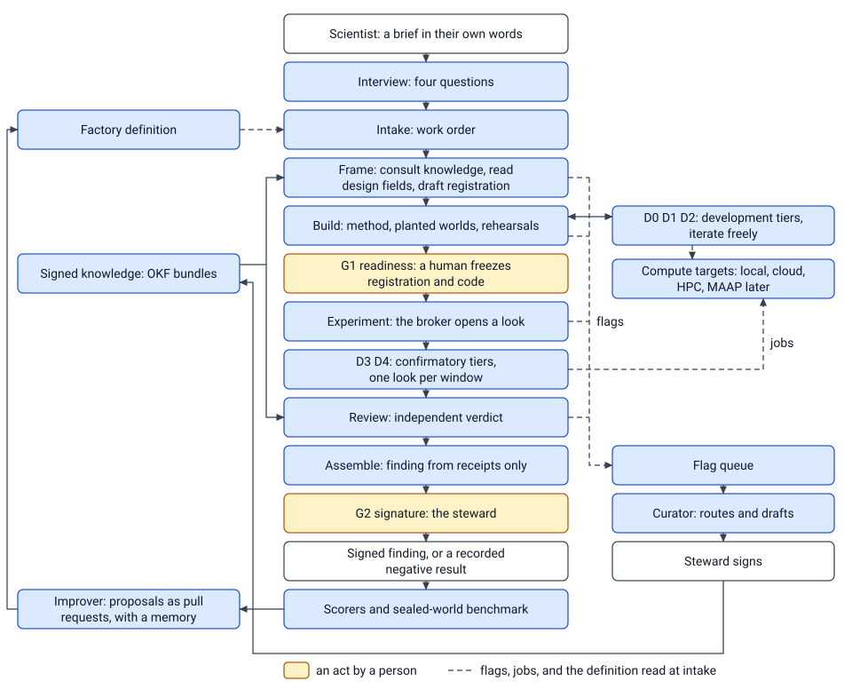

# Rename history

*History: the words and names this factory used before, for anyone reading an older record, review or commit. Today's words are in [docs/WORDS.md](../WORDS.md).*

The factory changed its words three times on 2026-11-25 and 2026-11-26: once to plain words a scientist uses, once to put the names on disk in step with the words, and once to follow the layout of Warp Factories and the owner's vocabulary. The long review files, written in between, keep the words of their day; they are now in `docs/history/reviews/`. The full layered list that stood here is in the git history of `docs/WORDS.md`.

## The main renames

| Before | Now |
|---|---|
| work order | study |
| brief | request |
| registration | analysis plan |
| D0, D1 planted truth, D2 development data, D3 confirmatory data | plan check, known-answer test, working data, held-out data (and in the scientist's word, fresh data) |
| G1, freeze; G2 | the lock; the steward's signature |
| look (of held-out data) | opening |
| broker | access gate |
| ledger | study log |
| spine | study tool |
| blueprint, factory definition, then the procedure | the definition (the `factory/` tree); "procedure" now means only the list of stages |
| flag | note |
| foreman, framer, curator, reviewer, then assistants | the coordinating, analysis, curating and review agents |
| scorers, then deterministic scorers | checks (the files stay in `scorers/`) |
| hypothesis card | lead |
| an item a review raised: a finding | a hole ("finding" is only the signed result) |
| capability (one factory per capability) | the `home` block: the repository where the science lives |
| bundle, concept | wiki, page |
| place (where a job computes) | runner |
| runner (what starts an agent) | harness |
| harness (the script that drives the blind test) | driver |
| practice run | practice |

## Names on disk

| Before | Now |
|---|---|
| `mvp/` | `tools/`, `factory/`, `methods/`, `compute/` |
| `work-orders/WO-0000` | `studies/STUDY-0000` |
| `registration.yaml`, `ledger.jsonl`, `looks.jsonl` | `analysis-plan.yaml`, `study-log.jsonl`, `openings.jsonl` |
| `improvement-memory.jsonl` | `factory/change-log.jsonl` |
| `flags/FLAG-001.json` | `notes/NOTE-001.json` |
| `d1_experiments.py`, `worlds.py`, `acceptance.py` | `known_answer_tests.py`, `test_cases.py`, `system_trial.py` |
| `compute/targets.yaml`, then `compute/places.yaml` | `factory/runners/<name>.yaml` |
| `assistants/<name>.md` | `factory/agents/<name>/agent.md` |
| `factory/procedure.yaml` | `factory/factory.yaml` |
| `name: osp-science-factory`; the `capability` block | `name: science-factory`; the `home` block |
| `docs/DESIGN.md`, `docs/PLAN.md`, `docs/TWO-WAYS-OF-WORKING.md` | `docs/HOW-IT-WORKS.md`, `docs/CREATE-A-FACTORY.md`, `docs/FIRST-STUDY.md`, `compute/README.md`; the old pages are in git history only |
| `docs/reviews/ASSISTANTS-AND-EXPLORING.md`, then `docs/reviews/AGENTS-AND-EXPLORING.md` | `docs/history/reviews/AGENTS-AND-EXPLORING.md` |
| `docs/reviews/RED-TEAM.md`, `docs/reviews/SCIENTISTS.md` | `docs/history/reviews/`; the register stays at `docs/reviews/README.md` |
| `docs/roadmap-initiative.yaml` | removed: GitHub issues, milestones and a Project board take its place |

## Options and keys

| Before | Now |
|---|---|
| `--wo`, `--tier D1`, `look --tier D3` | `--study`, `test known-answers`, `open-held-out` |
| `--procedure`, `--place` | `--factory`, `--runner` |
| `flag --note`, `resolve --flag` | `note --text`, `resolve --note` |
| plan keys `estimand`, `data.development`, `data.confirmatory`, `outcome_fields`, `design_fields`, `look_budget` | `quantity_estimated`, `data.working`, `data.held_out`, `withheld_values`, `observation_metadata`, `openings_allowed` |
| plan key `claim_class` | removed |
| request line "What could be held out" | "Data I have not looked at" |

## The records that were here

Until November 2026 this repository kept the runs it had made: two practice runs, a blind test, and a demo on real data run twice. They were taken out when the repository became the factory only, because a record names the code it ran by checksum and stops matching tools that go on changing. They are at commit `ad0c459`, which is in the history of `main`, and at the branch `records-2026-11` where the repository is published on GitHub, with the tools as they stood then. A number the reviews cite from one of those records is historical.

