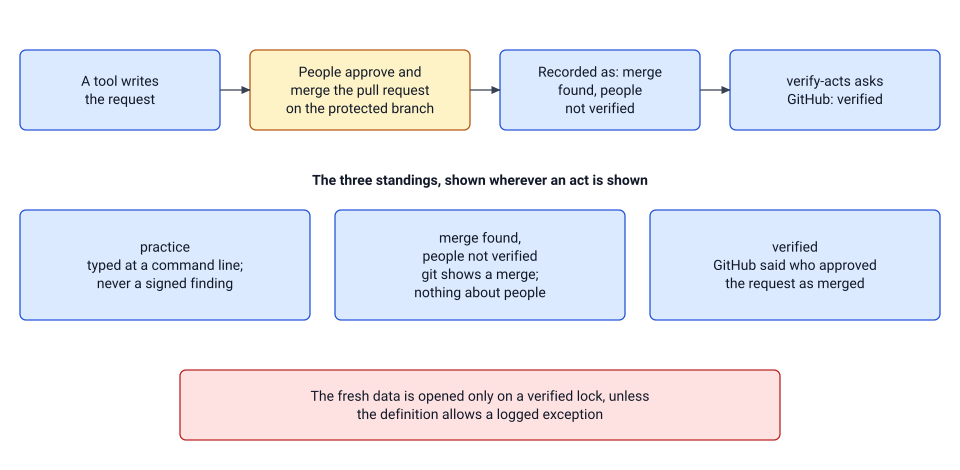

# The GitHub harness: the lock and the signature as pull requests

The lock and the steward's signature are the two acts no agent makes. On one machine, where agents and people share one account, a name typed after `--by` cannot settle who acted. So in a real study each act is a pull request in the repository where the study lives, approved and merged on a protected branch, and GitHub decides who a person is. A clone cannot prove that people acted, so the study tool gives every act one of three standings, and only GitHub's own answer, asked by `sf.py verify-acts`, makes one `verified` (`docs/WHAT-IS-ENFORCED.md` has the table).



**None of this has run on GitHub.** The scripts are tested as programs, on a throwaway repository and on answers written by hand in GitHub's shapes (`fixtures/`). The workflow file has never been started by GitHub, and `verify_acts.py` has never asked GitHub anything: its endpoints and the shapes of their answers are written from GitHub's documentation.

## What is in this folder

| File | What it is |
|---|---|
| `acts.workflow.yml` | the workflow, as a template: copy it to `.github/workflows/acts.yml` of the repository where the studies live |
| `verify_request.py` | the required check on a pull request that touches a study's `lock-request/` or `signature-request/` |
| `record_act.py` | the job after the merge: writes the act into the study log as a merge found, then has GitHub asked |
| `verify_acts.py` | what `sf.py verify-acts` runs: asks GitHub about the pull request, its reviews and the branch; holds the one function that calls GitHub |
| `CODEOWNERS.template` | who must approve a pull request that touches a request, the tools, the definition or the workflows |
| `fixtures/` | answers in GitHub's shapes, with placeholder logins, for the self-tests |
| `harness.yaml` | what this harness holds, and the address and token variables of the verification |

## How an act goes

1. An agent or a person writes the request: `uv run tools/sf.py request-lock --study studies/<study> --by <name>`, with `--model <model>` when an agent runs it. The tool makes every check the lock makes, and writes `lock-request/EVIDENCE.md` (what a person is asked to approve, in plain words, the proposal of the fresh data among it) and `manifest.json` (the checksums of everything the lock would bind). It records nothing as locked.
2. The study is committed on a branch, and a pull request is opened against the protected branch.
3. The check `request-check` runs `verify_request.py` with the scripts, tools and definition of the protected branch, never those of the pull request. It passes when the manifest matches the files, the pull request targets the protected branch and changes nothing in `tools/`, `factory/` or `.github/`, enough people other than its author approve it, and no commit after an approval changed what it covered. It puts the evidence summary on the pull request.
4. The people the definition names read it, approve, and merge. The merge is the act.
5. The job `record` runs `record_act.py`: the study tool writes the act into the study log under `platform:github`, standing as `merge found, people not verified`; then `sf.py verify-acts` asks GitHub and records the answer, after which the act stands as `verified`. The job commits the log.
6. The opening of the fresh data (`sf.py open-held-out`) asks GitHub again for itself, so it needs a network and a read token in `GH_TOKEN`. Without GitHub's answer it is refused and not used up. `--people-not-verified "REASON"` is refused unless the definition says `opening_without_verification: allowed-with-a-reason`.
7. Anybody can verify again, at any time, also on a closed study: `GH_TOKEN=... uv run tools/sf.py verify-acts --study studies/<study> --by <name>` (`--report-only` writes nothing).

The signature goes the same way, with `sf.py request-signature --decision signed` (or `declined`) and the folder `signature-request/`.

## The checklist, done once for a repository

1. Put copies of `tools/`, `factory/` and, for the built-in method, `methods/` in the repository where the studies live, by a pull request (`docs/CREATE-A-FACTORY.md`, "Start in five steps").
2. Copy `acts.workflow.yml` to `.github/workflows/acts.yml`. If the protected branch is not `main`, change `branches:` in the workflow and `protected_branch:` in `factory/factory.yaml` to the same name. Put the repository's owner/name in `repository:` of both acts.
3. Copy `CODEOWNERS.template` to `.github/CODEOWNERS` with real logins or teams.
4. Protect the branch: require a pull request before merging; require at least as many approvals as `approvals:` says; require review from code owners; dismiss stale approvals on new commits; require the status check `request-check`; require branches to be up to date; do not let administrators bypass; restrict who can push; no force pushes. Allow merge commits, and switch squash and rebase merging off (a squash merge is taken only if `merge_methods` lists `squash`; a rebase merge never).
5. Let the workflow's own identity push the one commit that records an act: allow `github-actions[bot]` to bypass the pull request rule, and nobody else. If that is not acceptable, have the `record` job open a pull request with the log instead.
6. The token for the verification, with the least it needs. In the workflow it is the job's own token. For a person who opens fresh data or verifies from a clone: a fine-grained token for this one repository, with read access to Contents and Pull requests, given as `GH_TOKEN` (or `SF_PLATFORM_TOKEN`) for that one command, never written into a file. With read access to Administration too, the verification also sees the branch protection in full.
7. Take one pull request through, and see the summary appear, the act recorded, and `sf.py status` show its standing go from `merge found, people not verified` to `verified`. Then run `verify-acts` from a fresh clone with a token of your own. Nobody has done this step: it is the first run of the route on GitHub, and what it shows wrong in `verify_acts.py` is fixed before a real study relies on it.

## Tracking studies on GitHub, set up once

**Labels.** The stage labels and the others are listed, with colours and descriptions, in `.github/labels.yml`. Make them, or bring them level, with one command that can be run again at any time (it needs `gh`, logged in to the repository):

```
uv run --with pyyaml python3 -c 'import subprocess, yaml
for l in yaml.safe_load(open(".github/labels.yml")):
    subprocess.run(["gh", "label", "create", l["name"], "--color", l["color"], "--description", l["description"], "--force"], check=True)'
```

**The request form.** `.github/ISSUE_TEMPLATE/request.yml` is the request as an issue form, labelled `stage: ask`. The issue is the study's tracking issue: save its text as the study's `request.md` and start the study with `sf.py start --request`, which binds it by checksum. Post the log fingerprints there.

**Milestones.** One milestone for the system trial and one for the first real study, each holding the issues it needs: the request, the holes a review raises (`hole`), what is owed (`owed`), and the decisions for the steward (`decision`, closed by the comment that decides).

**A Project board.** One board for the repository, with one item for each study's tracking issue, and three fields:

| Field | Kind | Values |
|---|---|---|
| Stage | single select | ask, plan, test, lock, open, review, signature, learn, closed |
| Kind of study | single select | exploring, confirming, system trial |
| Waiting on a person | single select | yes, no |

Save a view "Waiting on a person", filtered to that field, so the lock and signature requests and the drafts to accept are in one place. Keep the Stage field and the `stage:` label in step by hand; nothing sets them yet.

## Practice

`sf.py lock --local-practice --by human:<id> --evidence <an https link>` records a lock from the command line, and `sf.py signature --local-practice` the same, for trying the tools out, for the examples and for the self-tests. Such a study says so in `status`, on its scorecard and in its finding, opens its fresh data only with `open-held-out --local-practice`, and never closes as a signed finding. Its standing is `practice`.
